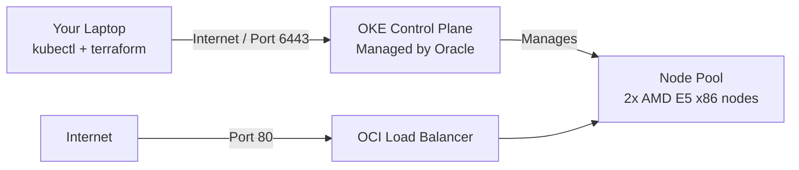

# Section 3: Provisioning a Managed OKE Cluster with Terraform for CKAD Practice

Welcome to Section 3 of the Kubernetes Scaling Workshop!

If you are preparing for the **CKAD (Certified Kubernetes Application Developer)** exam, you do not need to know how to install Kubernetes components (like `kubeadm`, `kubelet`, or `containerd`) from scratch. Instead, you need a functional, standard Kubernetes cluster where you can practice deploying pods, managing configurations, setting up network policies, and troubleshooting applications.

In this guide, we will use **Terraform** to provision a small, cost-effective **Oracle Kubernetes Engine (OKE)** cluster on **Oracle Cloud Infrastructure (OCI)**, and configure your laptop to connect to it.

> **Never used Oracle Cloud before?** That's expected. Your instructor has already created an account for you. Follow every step in order and you will not need anything else.

> [!TIP]
> **Attending the GCP version of the workshop?** You received a kubeconfig by email instead of an Oracle account. Skip this page and follow [**GCP lab version: Connect to the workshop cluster**](gke/README.md).

---

## 🏛️ Architecture Overview

Managed OKE clusters handle the complex control plane (API Server, scheduler, etcd) automatically, so we only pay for a couple of small worker nodes.



*   **OKE Control Plane**: Managed by Oracle: the Kubernetes API server, etcd, scheduler and controllers run on Oracle's machines, not yours. This workshop uses an **Enhanced cluster** (see below).

> **What is an Enhanced cluster?** OKE offers two cluster types:
>
> | | **Basic** | **Enhanced** (what we use) |
> |---|---|---|
> | Kubernetes you get | Standard, CNCF-conformant | Identical, the same `kubectl`, YAML and CKAD skills |
> | Control-plane cost | Free | About **$0.10 per cluster per hour** (paid by the workshop, not you) |
> | Clusters per region | **15, fixed** by Oracle, can't be raised | 15 by default, **raisable** on request |
> | Extras | none | Financially backed uptime SLA, virtual nodes, workload identity, add-on management |
>
> We use Enhanced for one practical reason: a room full of people needs more than 15 clusters, and Basic can't go higher. Nothing in the exercises depends on the extras. The worker nodes, load balancers and disks cost the same with either type. You'll see `ENHANCED_CLUSTER` in [oke.tf](terraform/oke.tf) and "Enhanced" next to your cluster in the console.
*   **Node Pool**: Two worker nodes of shape `VM.Standard.E5.Flex` (1 OCPU / 2 vCPUs, 8 GB RAM each). These are standard **x86_64** (AMD) machines, the same CPU architecture as most laptops and most images on Docker Hub.
*   **Network**: Your own private network (VCN). Worker nodes have **no public IPs**; the outside world reaches your apps through an OCI Load Balancer.

> **Your own compartment.** In OCI, a *compartment* is a folder that holds cloud resources and decides who can touch them. Your instructor created one just for you, named after your email address: `jsmith@example.com` becomes **`lab:jsmith_example.com`**. You have full control inside it and no write access anywhere else, so you can't break anyone else's cluster, and they can't break yours. Step 2.5 shows how to find it.

---

## 📬 Step 0: Activate Your Oracle Cloud Account

1.  Find the email from **Oracle Cloud** (subject similar to *"Activate your Oracle Cloud account"*). Check spam if it's missing, and tell your instructor if you can't find it — they can resend it.
2.  Click the activation link and choose a password.
3.  Sign in. You should land on the OCI Console. In the top-right **region selector**, make sure it says **US East (Ashburn)**.

That's it for the browser. Everything else happens in your terminal.

---

## 🛠️ Step 1: Install Required Tools on Your Laptop

You need three tools:
1.  **Terraform**: To provision the OKE infrastructure.
2.  **OCI CLI**: To log in to Oracle Cloud and fetch cluster credentials.
3.  **kubectl**: The official Kubernetes command-line tool.

### 1.1 Install Terraform

#### 🍎 macOS (Using Homebrew)
If you don't have Homebrew, install it from [brew.sh](https://brew.sh). Then run:
```bash
brew tap hashicorp/tap
brew install hashicorp/tap/terraform
```

#### 🪟 Windows (Using Winget)
Open PowerShell as Administrator and run:
```powershell
winget install HashiCorp.Terraform
```

#### 🐧 Linux (Debian/Ubuntu)
```bash
wget -O- https://apt.releases.hashicorp.com/gpg | sudo gpg --dearmor -o /usr/share/keyrings/hashicorp-archive-keyring.gpg
echo "deb [signed-by=/usr/share/keyrings/hashicorp-archive-keyring.gpg] https://apt.releases.hashicorp.com $(lsb_release -cs) main" | sudo tee /etc/apt/sources.list.d/hashicorp.list
sudo apt-get update && sudo apt-get install terraform
```

---

### 1.2 Install the OCI CLI

#### 🍎 macOS
```bash
brew install oci-cli
```

#### 🪟 Windows
Open PowerShell as Administrator and run:
```powershell
Set-ExecutionPolicy RemoteSigned -Scope Process
powershell -NoProfile -ExecutionPolicy Bypass -Command "iex ((New-Object System.Net.WebClient).DownloadString('https://raw.githubusercontent.com/oracle/oci-cli/master/scripts/install/install.ps1'))"
```
Accept the defaults, then **open a new terminal**.

#### 🐧 Linux
```bash
bash -c "$(curl -L https://raw.githubusercontent.com/oracle/oci-cli/master/scripts/install/install.sh)" -- --accept-all-defaults
exec -l $SHELL
```

Check it worked:
```bash
oci --version
```

---

### 1.3 Install kubectl

#### 🍎 macOS
```bash
brew install kubectl
```

#### 🪟 Windows
```powershell
winget install Kubernetes.kubectl
```

#### 🐧 Linux
```bash
sudo apt-get update && sudo apt-get install -y apt-transport-https ca-certificates curl gpg
sudo mkdir -p /etc/apt/keyrings
curl -fsSL https://pkgs.k8s.io/core:/stable:/v1.31/deb/Release.key | sudo gpg --dearmor -o /etc/apt/keyrings/kubernetes-apt-keyring.gpg
echo 'deb [signed-by=/etc/apt/keyrings/kubernetes-apt-keyring.gpg] https://pkgs.k8s.io/core:/stable:/v1.31/deb/ /' | sudo tee /etc/apt/sources.list.d/kubernetes.list
sudo apt-get update && sudo apt-get install -y kubectl
```

---

## 🔐 Step 2: Log In to OCI from Your Terminal

Terraform and kubectl need to act **as you**. The OCI CLI can set that up with a single browser login — no keys to copy, no IDs to look up.

> **Already use the OCI CLI for another Oracle account?** Add `--profile ckad` to the `bootstrap` command below, and set `oci_profile = "ckad"` in Step 3. That keeps your existing setup untouched.

Run:
```bash
oci setup bootstrap
```

Answer the prompts like this:

| Prompt | Answer |
|---|---|
| Enter a region | `us-ashburn-1` |
| *(a browser window opens)* | Sign in with your workshop **email and password** from Step 0 |
| Enter a passphrase for your private key | Press **Enter** (leave empty) |
| Config file / profile name / key location | Press **Enter** to accept each default |

What just happened? The CLI generated a key pair on your laptop, used your browser login to upload the **public** half to *your* Oracle account, and wrote `~/.oci/config` so every later command can sign requests as you. The private key never leaves your machine.

**Verify it** — this must print a list of regions, not an error:
```bash
oci iam region list --output table
```

> If the CLI prints a warning about file permissions, run the `oci setup repair-file-permissions ...` command it suggests.

**Where are my credentials?** `oci setup bootstrap` wrote everything Terraform needs to two places on your laptop:

| File | What's in it |
|---|---|
| `~/.oci/config` | A `[DEFAULT]` profile (or the name you gave `--profile`) with your `user` OCID, `tenancy` OCID, `region`, key `fingerprint` and `key_file` path. |
| `~/.oci/sessions/…` or `~/.oci/*.pem` | Your **private** API key. Never commit it or share it. |

The Terraform OCI provider reads that profile directly (`config_file_profile = var.oci_profile` in [versions.tf](terraform/versions.tf)). So you never paste OCIDs or keys into Terraform; you only tell it which profile to use, which is `DEFAULT` unless you changed it.

---

## 🗂️ Step 2.5: Find Your Compartment

Your compartment name is your invite email with `@` swapped for `_`, inside the workshop compartment `lab`:

| Your email | Your compartment |
|---|---|
| `jsmith@example.com` | `lab:jsmith_example.com` |
| `Ana.Lee@school.edu` | `lab:ana.lee_school.edu` (always lowercase) |

**From the terminal** (add `--profile ckad` if you used one). This must print exactly one row:
```bash
LAB=ocid1.compartment.oc1..aaaaaaaadgxmy5slqfhbbxi7zbefli3fadsyvg3fng5ppti6amfe3r3uxhgq
ME=$(echo "you@example.com" | tr 'A-Z' 'a-z' | tr '@' '_')   # <-- your email
oci iam compartment list --compartment-id "$LAB" --name "$ME" \
  --query 'data[].{name:name, ocid:id, state:"lifecycle-state"}' --output table
```

**From the console:** ☰ menu → **Identity & Security** → **Compartments** → click **lab** → your compartment is listed under *Child Compartments*. Whenever the console asks for a compartment (for example on the *Kubernetes Clusters (OKE)* page), choose **lab → your compartment**, or you'll see an empty list.

You don't need to copy the OCID anywhere: Terraform looks the compartment up from your email in the next step.

---

## 🚀 Step 3: Provision the OKE Cluster

1.  Open your terminal and navigate to the Terraform directory:
    ```bash
    cd "section 3/terraform"
    ```
2.  Copy the example variables file:
    ```bash
    cp terraform.tfvars.example terraform.tfvars
    ```
3.  Open `terraform.tfvars` in your editor and change **one** line, your email:
    ```hcl
    # terraform.tfvars
    lab_compartment_ocid = "ocid1.compartment.oc1..aaaa…"   # prefilled, leave it
    email                = "jsmith@example.com"            # <-- the address your invite went to
    # oci_profile        = "ckad"                          # only if you used --profile in Step 2
    ```
    | Variable | What it is |
    |---|---|
    | `lab_compartment_ocid` | The workshop compartment that holds everyone's personal compartments. Prefilled. |
    | `email` | Your invite email. Terraform turns it into `lab:jsmith_example.com` and builds everything there. |
    | `oci_profile` | Which login from Step 2 to use. Defaults to `DEFAULT`. |

    Terraform checks these before creating anything. If you forget to change `email`, it stops with *"Set email to the address your invite was sent to"*. If the email doesn't match a compartment, it stops with *"No compartment named '…' under the workshop compartment"*.
4.  Initialize Terraform:
    ```bash
    terraform init
    ```
5.  Generate the deployment plan:
    ```bash
    terraform plan
    ```
    It should end with `Plan: 14 to add, 0 to change, 0 to destroy.`
6.  Apply the configuration (type `yes` when prompted):
    ```bash
    terraform apply
    ```

It takes about **10 to 15 minutes** for OCI to provision the network, control plane, and worker nodes. Once completed, Terraform will display output similar to this:

```text
Apply complete! Resources: 14 added, 0 changed, 0 destroyed.

Outputs:
cluster_id = "ocid1.cluster.oc1.iad.aaaa…"
cluster_name = "ckad-jsmith"
compartment_name = "lab:jsmith_example.com"
compartment_ocid = "ocid1.compartment.oc1..aaaa…"
kubeconfig_command = "oci ce cluster create-kubeconfig --cluster-id ocid1.cluster.oc1.iad.aaaa… --file $HOME/.kube/config --region us-ashburn-1 --token-version 2.0.0 --kube-endpoint PUBLIC_ENDPOINT --profile DEFAULT"
kubernetes_version = "v1.xx.x"
```

---

## 🔑 Step 4: Retrieve Your Kubeconfig

The `kubeconfig` is a configuration file (`~/.kube/config`) that contains credentials, endpoints, and contexts used by your local `kubectl` client to securely communicate with the Kubernetes cluster.

### 4.1 Download the Cluster Credentials
Run the helper command from the Terraform outputs:

```bash
$(terraform output -raw kubeconfig_command)
```

*(On Windows PowerShell, run `terraform output -raw kubeconfig_command`, then copy and paste the command it prints.)*

#### What does this command do?
1.  Queries the OCI API for the public endpoint and TLS certificate authority of your OKE cluster.
2.  Inserts a new cluster, user and context into your local `~/.kube/config` file.
3.  Sets your terminal's default Kubernetes context to the new OKE cluster.
4.  Configures `kubectl` to call `oci ce cluster generate-token` whenever it needs a fresh, short-lived login token — using the same OCI login you set up in Step 2.

### 4.2 Understanding your Kubeconfig File

Now that your credentials are downloaded, it is important to understand how Kubernetes knows where to send your commands. The configuration file is stored at `~/.kube/config` (or `C:\Users\<username>\.kube\config` on Windows).

If you open the file (or run `kubectl config view`), you will see a YAML document with these primary blocks:

1.  **`clusters`**: A list of all the Kubernetes API Servers you can connect to. Each entry contains:
    *   `server`: The public URL of the control plane (e.g., `https://129.213.x.x:6443`).
    *   `certificate-authority-data`: Cryptographic keys used to verify that the server is authentic.
2.  **`users`**: A list of credentials used to authenticate you to the clusters. For OKE, this is an `exec` block that runs the `oci` CLI to request short-lived tokens.
3.  **`contexts`**: A list of connections linking a **User** to a **Cluster**. For example:
    *   "Use credentials for `user-c1234` to connect to `cluster-c1234`."
    *   A context can also define a `namespace` so that `kubectl` commands default to that namespace automatically.
4.  **`current-context`**: A single string indicating which context is active right now. When you run `kubectl get pods`, the CLI reads `current-context` to determine which cluster and credentials to use.

#### Useful `kubectl` Config Commands (Essential for CKAD):
Since the CKAD exam uses multiple clusters, you must know how to view and navigate contexts:

```bash
# View your sanitized kubeconfig (hides certificates for readability)
kubectl config view

# List all available contexts in your config
kubectl config get-contexts

# Show the active context name
kubectl config current-context

# Switch to a different context (very common during the exam!)
kubectl config use-context <context-name>

# Change the default namespace for your current context (saves typing -n <namespace>)
kubectl config set-context --current --namespace=<namespace-name>
```

---

## 🔍 Step 5: Verify Cluster Connectivity

1.  **Check Cluster Information**:
    ```bash
    kubectl cluster-info
    ```
    *This should output details about the active Kubernetes control plane.*

2.  **List Deployed Nodes**:
    ```bash
    kubectl get nodes -o wide
    ```
    *You should see two nodes in the `Ready` status, running Oracle Linux:*
    ```text
    NAME          STATUS   ROLES   AGE   VERSION   INTERNAL-IP    OS-IMAGE                  CONTAINER-RUNTIME
    10.0.10.23    Ready    node    3m    v1.xx.x   10.0.10.23     Oracle Linux Server 8.10  cri-o://1.xx.x
    10.0.10.187   Ready    node    3m    v1.xx.x   10.0.10.187    Oracle Linux Server 8.10  cri-o://1.xx.x
    ```

3.  **Practice Deployment (CKAD Test)**:
    ```bash
    # Spin up an Nginx Pod
    kubectl create deployment nginx-practice --image=docker.io/library/nginx

    # Verify that the Pod transitions to 'Running'
    kubectl get pods

    # Clean up the practice deployment
    kubectl delete deployment nginx-practice
    ```

4.  **Expose an App to the Internet (LoadBalancer)**:
    ```bash
    kubectl apply -f ../manifests/hello-lb.yaml

    # Wait until EXTERNAL-IP changes from <pending> to an IP (1-3 minutes), then Ctrl+C
    kubectl get svc hello -w

    curl http://<EXTERNAL-IP>
    ```
    *You should see the "Welcome to nginx!" page. Behind the scenes, OKE asked OCI to create a real cloud load balancer in your public subnet.*

    Clean it up when you're done — load balancers cost money while they exist:
    ```bash
    kubectl delete -f ../manifests/hello-lb.yaml
    ```

You are now ready to run and practice any CKAD questions, deployments, network policies, or configurations!

---

## 🗑️ Step 6: Teardown and Cleanup

To stop paying for resources after you are done practicing:

1.  **Delete any LoadBalancer Services and PersistentVolumeClaims first.** Kubernetes created those cloud resources, not Terraform, so Terraform doesn't know about them and `destroy` will hang on the subnet:
    ```bash
    kubectl delete svc --all-namespaces --field-selector spec.type=LoadBalancer
    kubectl delete pvc --all --all-namespaces
    ```
2.  Return to the Terraform directory:
    ```bash
    cd "section 3/terraform"
    ```
3.  Run the destroy command and type `yes` to confirm:
    ```bash
    terraform destroy
    ```
    All resources (OKE cluster, node pool, VCN, subnets, gateways) will be deleted.

---

## 🧯 Troubleshooting

| Symptom | Fix |
|---|---|
| `oci setup bootstrap` browser page says your login failed | Make sure you finished Step 0 and are using the workshop email. |
| `NotAuthenticated` / `401` | Your login from Step 2 isn't being used. Re-run `oci iam region list`; if you used `--profile`, set `oci_profile` to match. |
| `No compartment named '…' under the workshop compartment` | `email` in `terraform.tfvars` doesn't match your invite address, or your instructor hasn't created your compartment yet. Run the Step 2.5 command to check. |
| `NotAuthorizedOrNotFound` / `404` | `lab_compartment_ocid` was changed (copy it again from `terraform.tfvars.example`), you're signed in with the wrong profile, or your workshop access has ended. |
| `Out of host capacity` | Oracle is temporarily out of machines of this shape. Wait a few minutes and run `terraform apply` again. |
| `QuotaExceeded` / `LimitExceeded` | Your compartment's quota (4 OCPUs, 1 cluster, 400 GB storage, 3 load balancers) is used up, often by a cluster you forgot to destroy. If not, tell your instructor. |
| `kubectl` says `error: exec plugin ... oci` | The `oci` CLI isn't on your PATH in this terminal. Open a new terminal or reinstall it (Step 1.2). |
| Pod stuck in `ImageInspectError`: *"short name mode is enforcing"* | OKE nodes run CRI-O, which refuses ambiguous short names like `nginx`. Use the full name: `docker.io/library/nginx:1.25-alpine`. Every manifest in this repo already does. |
| `terraform destroy` hangs on a subnet | A LoadBalancer Service still exists. Run Step 6.1, then `terraform destroy` again. |
