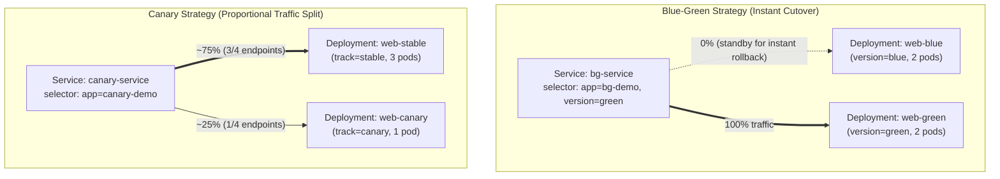

# Section 4: Kubernetes Core Concepts (Pods, Deployments, and Networking)

Welcome to Section 4 of the Kubernetes Scaling Workshop! 

This section covers the core concepts required for the **CKAD (Certified Kubernetes Application Developer)** exam. We will explore **Pods, Containers, Runtimes, Deployments, ReplicaSets, Services, and Networking**.

For each concept, you will practice:
1.  **The Imperative Way**: Creating resources quickly using `kubectl` CLI commands (essential for saving time during the CKAD exam).
2.  **The Declarative Way**: Defining resources in YAML manifests and applying them (essential for real-world production setups).
3.  **State Inspection**: Investigating resources using `kubectl describe`, `-o yaml`, and `kubectl get -w` to understand the difference between the **desired state** (what you configured) and the **deployed state** (what is actually running).

---

## 📦 Module 1: Pods, Containers, and Runtimes

A **Pod** is the smallest deployable unit in Kubernetes. It represents a single instance of a running process and can contain one or more tightly coupled containers.

### 1.1 Container Runtime Interface (CRI)

The Kubernetes control plane communicates with the container runtime (e.g., `containerd` or `CRI-O`) on each node via the **CRI** to manage container lifecycles.

#### How to Inspect the Active Container Runtime:
Run the following command on your local machine:
```bash
kubectl get nodes -o wide
```
Look at the **`CONTAINER-RUNTIME`** column. Depending on your cluster you will see `containerd://1.x.x` (GKE, most clusters) or `cri-o://1.x.x` (Oracle OKE). Kubernetes doesn't care which one: both speak the same CRI.

> [!NOTE]
> On the shared workshop cluster you have **read-only** access to nodes: `get` and `describe` work, but changing nodes doesn't.

> [!NOTE]
> On self-managed clusters (like the `kubeadm` setup), if you SSH directly into a node, you can use the low-level **`crictl`** command-line tool (which is pre-configured to talk to the CRI socket) to inspect containers:
> ```bash
> # Run these on a node VM:
> sudo crictl info
> sudo crictl ps
> ```

---

### 1.2 Pod Fundamentals

#### 1.2.1 The Imperative Way (Fast Deployment & Dry-Run YAML Generation)
Generate and deploy a single Nginx pod instantly:
```bash
kubectl run nginx-imperative --image=docker.io/library/nginx:1.25-alpine
```
*Verify it is running:*
```bash
kubectl get pods
```

> [!NOTE]
> **Why did `kubectl` print `Warning: would violate PodSecurity "restricted:latest"...`?**
> When you create a standard `nginx` Pod, you will see:
> ```text
> Warning: would violate PodSecurity "restricted:latest": allowPrivilegeEscalation != false (container "nginx-custom" must set securityContext.allowPrivilegeEscalation=false), unrestricted capabilities (container "nginx-custom" must set securityContext.capabilities.drop=["ALL"]), runAsNonRoot != true (pod or container "nginx-custom" must set securityContext.runAsNonRoot=true), seccompProfile (pod or container "nginx-custom" must set securityContext.seccompProfile.type to "RuntimeDefault" or "Localhost")
> ```
> **Your Pod was still created and runs normally!** Here is why you see that message:
> *   Your workshop namespace is configured with Kubernetes **Pod Security Admission (PSA)** set to **enforce `baseline`** (which blocks truly dangerous settings like `privileged: true` or `hostPath` mounts) while **warning on `restricted`** (`pod-security.kubernetes.io/warn: restricted`).
> *   Because the default `nginx` image runs as `root` and doesn't drop Linux capabilities or set a `seccompProfile` out of the box, the API server prints a helpful advisory warning showing what would need to be hardened to meet the strict `restricted` profile.
> *   Deep-dive Pod Security Standards, Linux capabilities, and `seccompProfile` hardening are heavily **CKS (Certified Kubernetes Security Specialist)** topics, but we intentionally enabled the `restricted` warning mode on this cluster to expose you to how production Kubernetes admission controllers guide developers toward secure defaults! (You will also practice silencing every one of these warnings with a hardened `SecurityContext` in **[Section 8](../section%208/README.md)**.)

##### 💡 CKAD Exam Superpower: Imperative `--dry-run=client -o yaml` to a File
On the CKAD exam (and in day-to-day workflows), you should almost **never write a YAML manifest from scratch**. Instead, use an imperative `kubectl run` (or `kubectl create`) command with `--dry-run=client -o yaml` and redirect (`>`) the output into a file so you can edit and apply it!

1.  **Generate a Pod manifest without creating it on the cluster yet:**
    ```bash
    kubectl run nginx-custom --image=docker.io/library/nginx:1.25-alpine --port=80 --dry-run=client -o yaml > my-nginx.yaml
    cat my-nginx.yaml
    ```
2.  **Apply your generated manifest and check its running image version:**
    ```bash
    kubectl apply -f my-nginx.yaml
    kubectl get pod nginx-custom -o jsonpath='{.spec.containers[0].image}{"\n"}'
    ```
    *Output:* `docker.io/library/nginx:1.25-alpine`
3.  **Edit the manifest to upgrade the container image and watch it roll out live:**
    Open `my-nginx.yaml` in your editor (or use `sed` below) to change `nginx:1.25-alpine` to `nginx:1.26-alpine`:
    ```bash
    sed -i.bak 's/nginx:1.25-alpine/nginx:1.26-alpine/' my-nginx.yaml
    ```
    Now apply the updated manifest and watch (`-w`) Kubernetes pull the new `1.26-alpine` image and restart the container in-place:
    ```bash
    kubectl apply -f my-nginx.yaml
    kubectl get pod nginx-custom -w
    ```
    *(Press `Ctrl+C` once `STATUS` is `Running`.)*
4.  **Inspect the live cluster manifest (`-o yaml` / `describe`) to see the updated image and event history:**
    ```bash
    # Verify the live Pod manifest in the API server now reflects nginx:1.26-alpine (and RESTARTS incremented to 1!):
    kubectl get pod nginx-custom -o yaml | grep -E "image:|imageID:|restartCount:"
    kubectl describe pod nginx-custom | tail -n 12
    ```
    *Notice in the `Events:` table at the bottom of `kubectl describe` that the kubelet detected the `spec.containers[0].image` change in the manifest, pulled `nginx:1.26-alpine`, killed the old `1.25-alpine` container, and started the new version!*
    *(Clean up the temporary files when done: `rm -f my-nginx.yaml my-nginx.yaml.bak`.)*

#### 1.2.2 The Declarative Way (Pre-Written YAML Configuration)
Review the file [pod-single.yaml](manifests/pod-single.yaml):
```yaml
apiVersion: v1
kind: Pod
metadata:
  name: nginx-single
  labels:
    app: web-server
spec:
  containers:
  - name: nginx
    image: docker.io/library/nginx:1.25-alpine
    ports:
    - containerPort: 80
```
Deploy the manifest:
```bash
kubectl apply -f manifests/pod-single.yaml
```

#### 1.2.3 Inspecting Deployed (`status`) vs. Desired (`spec`) State
To inspect the full manifest stored in the Kubernetes API server for a running resource, output it as YAML:
```bash
kubectl get pod nginx-single -o yaml
```
*   **Desired State**: Defined in the **`spec`** block. This is the blueprint you submitted (e.g., `image: docker.io/library/nginx:1.25-alpine`).
*   **Deployed (Actual) State**: Stored in the **`status`** block. It contains dynamic runtime information like `podIP`, `phase: Running`, `containerStatuses` (including the exact resolved `imageID` SHA-256 digest and `restartCount`), start times, and node placement.

> [!WARNING]
> **Beware of "Unmanaged" (Naked) Pods in Production!**
> The Pods we just created (`nginx-imperative`, `nginx-custom`, and `nginx-single`) are **unmanaged ("naked") Pods**—meaning they were created directly as `kind: Pod` with no `ownerReferences` pointing to a higher-level controller like a **Deployment**, **ReplicaSet**, **StatefulSet**, or **Job**.
>
> **Why you should almost never run unmanaged Pods in production:**
> 1. **No Self-Healing Across Node Failures or Deletions**: While the local node's `kubelet` will restart a crashed container *inside* the Pod (as long as the node itself stays healthy), if someone runs `kubectl delete pod`, if the Pod is **evicted** due to node memory pressure, or if the **worker node dies or drains for an upgrade**, an unmanaged Pod is **gone forever**. No controller will reschedule it onto another node!
> 2. **Downtime During Updates & Immutable Fields**: As you saw when updating `nginx-custom` from `1.25-alpine` to `1.26-alpine`, Kubernetes had to kill the single running container in-place, causing a brief outage. Furthermore, almost every field on a running Pod *except* `spec.containers[*].image` (such as environment variables, volume mounts, or resource requests) is **immutable**—you cannot edit them without deleting and recreating the Pod!
> 3. **No Horizontal Scaling or Rollbacks**: You cannot run `kubectl scale` or `kubectl rollout undo` on a naked Pod.
>
> *(We use standalone Pods here and on the CKAD exam to learn Pod internals quickly, and in **Module 2** below you will see how wrapping your Pod template inside a **Deployment** solves all three risks!)*

#### 1.2.4 Multi-Container Pod Patterns (Sidecar, Init Containers, Ambassador)
Containers inside a single Pod share the **same network namespace** (they share the same IP address and can talk to each other via `localhost`) and can **share volumes** (`emptyDir`, `PersistentVolumeClaim`, `ConfigMap`).

The CKAD exam tests three core multi-container Pod patterns:

| Pattern | How it works | Common Use Cases |
| :--- | :--- | :--- |
| **1. Sidecar** | A helper container runs *alongside* the main container for the lifetime of the Pod, sharing a volume or network. | Log shippers (Fluent Bit), file/content syncers, service mesh proxies (Envoy). *(Note: Kubernetes 1.29+ also supports native sidecars via `initContainers` with `restartPolicy: Always`.)* |
| **2. Init Container** | Defined under `spec.initContainers`. Runs **to completion sequentially** *before* any application container in `spec.containers` starts. | Waiting for a database/service to be reachable, running DB schema migrations, seeding config or HTML files into a shared `emptyDir`. |
| **3. Ambassador** | A proxy container that listens on `localhost` inside the Pod and forwards outbound requests from the main app to external services. | TLS termination, routing to different dev/prod shards, adding auth headers or retries without changing the app code. |

##### Pattern A: The Sidecar Pattern ([pod-multi.yaml](manifests/pod-multi.yaml))
Review [pod-multi.yaml](manifests/pod-multi.yaml). It defines a `web-server` (`nginx`) container and a `content-generator` sidecar container that continuously writes timestamps to a shared `emptyDir` volume.

Deploy the multi-container pod:
```bash
kubectl apply -f manifests/pod-multi.yaml
```
Verify that both containers in the pod are ready (`READY 2/2`):
```bash
kubectl get pods
```
Verify they share storage. Exec into the `web-server` container to check if it serves the file written by the `content-generator` sidecar:
```bash
kubectl exec nginx-multi -c web-server -- wget -qO- http://localhost:80
```
*You should see output similar to:*
`Hello from the Sidecar Container! Time: Tue Oct 20 19:35:10 UTC 2026`

> [!IMPORTANT]
> **Understanding `emptyDir` vs. `hostPath` — and Why `emptyDir` is Risky for Stateful Workloads**
> Notice that `nginx-multi` shares files using an **`emptyDir: {}`** volume. The core difference between `emptyDir` and `hostPath` comes down to **data lifecycle, node coupling, and security**:
>
> | Dimension | `emptyDir` (Pod-Scoped Ephemeral) | `hostPath` (Node-Coupled Host Disk) |
> | :--- | :--- | :--- |
> | **Data Lifecycle** | Created dynamically when a Pod is scheduled to a node and **permanently deleted** the moment the Pod is removed (though it *does* survive individual container restarts within the same Pod). | Mounts a pre-existing directory directly from the worker node's OS filesystem. If the Pod dies, the files remain on *that specific node's* disk. |
> | **Security Risk** | Safe and isolated per Pod; allowed by `baseline` and `restricted` Pod Security profiles. | **High security risk** (blocked in our workshop by Pod Security `baseline`). A compromised Pod with `hostPath: /` can escape the container and take over the host node. |
> | **Primary Use Case** | Scratch space, local caches, or sharing transient files between containers in the **same Pod** (like our sidecar!). | Reserved almost exclusively for privileged cluster `DaemonSet`s (e.g., Fluent Bit, Prometheus Node Exporter) that must read node `/var/log` or system metrics. |
>
> **⚠️ The Risk of Relying on `emptyDir` for Production or Stateful Workloads:**
> 1. **Permanent Data Loss on Pod Rescheduling**: An `emptyDir` is tied to the **Pod's lifecycle**, not a persistent disk. Any routine Kubernetes event—a Deployment rolling update (`kubectl rollout`), a Pod eviction, a node drain, or `kubectl delete pod`—destroys the Pod and **wipes all data in `emptyDir` permanently**. Never store databases, user uploads, or model checkpoints in `emptyDir` (use a **`PersistentVolumeClaim` (`PVC`)**, which you will build in **[Section 5](../section%205/README.md)**!).
> 2. **Node Disk Exhaustion & Eviction**: By default, `emptyDir` uses the worker node's local boot disk (or node RAM if `emptyDir.medium: Memory` is set). If a container writes unbounded logs or temp files to `emptyDir` without setting `emptyDir.sizeLimit`, it can fill up the node's ephemeral storage (`DiskPressure`) and cause the `kubelet` to **evict your Pod**!

##### Pattern B: Init Containers ([pod-init.yaml](manifests/pod-init.yaml))
If an Init Container fails, Kubernetes restarts it until it succeeds (unless `restartPolicy: Never`). If a Pod has multiple `initContainers`, they run **one at a time in order**, and the main app container only starts after every Init Container exits `0`.

> [!TIP]
> **Real-World Spotlight: Istio Service Mesh (`istio-init` + `istio-proxy`)**
> **Istio** is one of the most famous (and infamous!) real-world examples of combining **both** an **Init Container** and a **Sidecar** in every Pod:
> 1. **`istio-init` (Init Container)**: Runs first with elevated network admin (`NET_ADMIN`) privileges to program `iptables` rules inside the Pod's network namespace, redirecting all inbound and outbound TCP traffic to port `15001`/`15006`—and then exits `0`.
> 2. **`istio-proxy` (Envoy Sidecar)**: Runs alongside your main application container for the lifetime of the Pod, intercepting that redirected traffic to handle mutual TLS (mTLS), retries, telemetry, and traffic routing automatically!

Review and apply [pod-init.yaml](manifests/pod-init.yaml):
```bash
kubectl apply -f manifests/pod-init.yaml
kubectl get pod pod-init-demo
```
*If you catch it within the first 2 seconds, `STATUS` shows `Init:0/1` -> `PodInitializing` -> `Running`.*

Wait for it to become Ready and verify that the `seed-html` init container populated `/usr/share/nginx/html/index.html` before exiting:
```bash
kubectl wait --for=condition=Ready pod/pod-init-demo --timeout=60s
kubectl exec pod-init-demo -c web-server -- wget -qO- http://localhost:80
kubectl logs pod-init-demo -c seed-html
```
*You will see `<h1>Initialized by Init Container at ...</h1>` and the init container's completion log!*

##### Pattern C: The Ambassador Pattern ([pod-ambassador.yaml](manifests/pod-ambassador.yaml))
In the Ambassador pattern, the main application is hardcoded to talk to `localhost:8080`. It has no idea where the real upstream service lives or how it's configured—an **ambassador proxy container** inside the same Pod listens on `localhost:8080`, injects headers/TLS, and forwards traffic to the upstream backend.

Review and apply [pod-ambassador.yaml](manifests/pod-ambassador.yaml):
```bash
kubectl apply -f manifests/pod-ambassador.yaml
kubectl wait --for=condition=Ready pod/pod-ambassador-demo --timeout=60s
```
Exec into the `app-client` container and make a request to **`localhost:8080`** (with `-S` to inspect response headers):
```bash
kubectl exec pod-ambassador-demo -c app-client -- wget -qSO- http://localhost:8080
```
*Notice two things in the output:*
1. The body returns `Response via Ambassador Proxy!` (from the upstream service on port `9000`).
2. The response headers include `X-Ambassador-Proxy: active`, injected transparently by the `ambassador-proxy` container over the Pod's shared `localhost` loopback interface!

---

### 1.3 Isolation (Linux Kernel Namespaces vs. Kubernetes Namespaces)

Kubernetes achieves container isolation using native Linux Kernel features:
*   **Cgroups (Control Groups)**: Directs resource usage (CPU, memory, disk I/O limit).
*   **Linux Namespaces**: Partitions kernel resources (Processes, Network interfaces, Mount points) so a process in a container cannot see processes or networks in other containers.

At the cluster layer, Kubernetes provides **Namespaces** to logically partition resources and scope access control.

#### Hands-On: Namespace Isolation

> [!NOTE]
> **Shared workshop cluster:** you can't create namespaces. You've been given one, and it's already your default. Steps 1–2 will return `Forbidden`, which is the isolation lesson itself. Do steps 3–4 with `kube-system` instead of `practice-ns`. On **your own cluster** you're the admin, and every step works.

1.  Create a new namespace imperatively:
    ```bash
    kubectl create namespace practice-ns
    ```
2.  Deploy a pod inside the new namespace:
    ```bash
    kubectl run nginx-isolated --image=docker.io/library/nginx:1.25-alpine -n practice-ns
    ```
3.  Check whether the pod is visible in your default view:
    ```bash
    kubectl get pods
    ```
    *(The pod won't appear: `kubectl` only shows your current namespace. Check which one that is with `kubectl config view --minify -o jsonpath='{..namespace}'`.)*
4.  Query the namespace explicitly:
    ```bash
    kubectl get pods -n practice-ns
    ```

---

### 1.4 Working with Labels (Imperative vs. Declarative)

**Labels** are key-value pairs attached to Kubernetes objects (like Pods). They do not provide direct function to the container, but are used to organize resources and select subsets of objects.

#### 1.4.1 The Imperative Way
You can add, update, and remove labels on running Pods directly using the `kubectl label` command:

```bash
# Add a label 'env=prod' to a pod
kubectl label pod nginx-single env=prod

# View all labels on your pods
kubectl get pods --show-labels

# Query/filter pods using a label selector (-l)
kubectl get pods -l env=prod

# Update/overwrite an existing label (requires --overwrite flag)
kubectl label pod nginx-single env=dev --overwrite

# Verify the label changed
kubectl get pods -l env=dev

# Remove a label (append a minus '-' sign to the key)
kubectl label pod nginx-single env-

# Verify the label is gone
kubectl get pods --show-labels
```

#### 1.4.2 The Declarative Way
In production, labels are defined inside the YAML manifest.
1. Open [pod-single.yaml](manifests/pod-single.yaml) in your editor.
2. Add a new label under `metadata.labels`:
   ```yaml
   metadata:
     name: nginx-single
     labels:
       app: web-server
       stage: training
   ```
3. Apply the changes:
   ```bash
   kubectl apply -f manifests/pod-single.yaml
   ```
4. Verify the label was added dynamically:
   ```bash
   kubectl get pod nginx-single --show-labels
   ```

---

### 1.5 Reading Container Logs

Reading container logs is one of the most critical troubleshooting skills for the CKAD.

#### 1.5.1 Single-Container Pod Logs
To view stdout/stderr from a standard single-container pod:
```bash
# Dump all current logs
kubectl logs nginx-single

# Stream logs in real-time (follow)
kubectl logs -f nginx-single

# View only the last 10 lines of logs
kubectl logs nginx-single --tail=10

# View logs from a container that recently crashed (previous run)
kubectl logs nginx-single --previous # Or -p
```

#### 1.5.2 Multi-Container Pod Logs
If a pod has more than one container, you **must** specify which container you want to query using the `-c` (or `--container`) flag. If you do not, the command will error.

Try running this:
```bash
# This will fail and list the container names:
kubectl logs nginx-multi
```
Now, retrieve logs from each specific container:
```bash
# View logs from the web server container
kubectl logs nginx-multi -c web-server

# View logs from the background content-generator sidecar
kubectl logs nginx-multi -c content-generator
```

---

## 🔄 Module 2: Application Lifecycle Management (Deployments & ReplicaSets)

In production, you rarely deploy Pods directly. Instead, you use controllers like **ReplicaSets** and **Deployments** to manage scaling, health, self-healing, and rolling updates.

### 2.1 ReplicaSets

A **ReplicaSet**'s purpose is to maintain a stable, running set of replica Pods at any given time.

1.  Review and deploy [replicaset.yaml](manifests/replicaset.yaml):
    ```bash
    kubectl apply -f manifests/replicaset.yaml
    ```
2.  Inspect the ReplicaSet and its pods:
    ```bash
    kubectl get replicaset
    kubectl get pods --show-labels
    ```
    *(Observe that 3 pods were spun up with the label `app=rs-web` matching the ReplicaSet selector).*

3.  **Self-Healing Experiment**:
    Open a second terminal window and watch the pods in real-time:
    ```bash
    kubectl get pods -w
    ```
    In your first terminal, manually delete one of the ReplicaSet pods:
    ```bash
    kubectl delete pod <name-of-one-replicaset-pod>
    ```
    *Observe that the moment the deletion begins, the ReplicaSet controller detects the difference between the desired state (3) and the actual state (2), and instantly triggers the creation of a replacement pod.*

---

### 2.2 Declarative Deployments

A **Deployment** wraps around a ReplicaSet. It provides declarative updates for Pods and ReplicaSets, enabling rolling releases and rollbacks.

#### 2.2.1 CKAD Tip: Generate a manifest template imperatively
Rather than writing YAML from scratch, you can generate a template:
```bash
kubectl create deployment nginx-deployment --image=docker.io/library/nginx:1.25-alpine --replicas=2 --dry-run=client -o yaml > dry-run-deployment.yaml
```
*Inspect `dry-run-deployment.yaml` to see how easy it is to generate clean YAML skeleton configurations.*

#### 2.2.2 Deploy and Inspect a Deployment
Deploy the pre-written [deployment.yaml](manifests/deployment.yaml):
```bash
kubectl apply -f manifests/deployment.yaml
```
Verify the hierarchy:
```bash
# Check the deployment
kubectl get deployments

# Check the ReplicaSet automatically generated by the Deployment
kubectl get replicasets

# Check the pods generated by the ReplicaSet
kubectl get pods
```

---

### 2.3 Scaling and Self-Healing

#### 2.3.1 Scaling a Deployment Up and Down
Scaling changes the **desired state** (number of replicas) of your deployment. The deployment controller will immediately spin up or terminate pods to reconcile the actual state.

*   **The Imperative Way (Scale Up to 5)**:
    Let's scale our deployment up to 5 replicas:
    ```bash
    kubectl scale deployment nginx-deployment --replicas=5
    ```
    *Track the scale-up in real-time:*
    ```bash
    kubectl rollout status deployment/nginx-deployment
    ```
    *Verify that you have 5 pods running:*
    ```bash
    kubectl get pods -l app=deploy-web
    ```

*   **The Declarative Way (Scale Down to 3)**:
    1. Open [deployment.yaml](manifests/deployment.yaml) in your editor.
    2. Change `replicas: 2` to `replicas: 3`.
    3. Apply the modified manifest:
       ```bash
       kubectl apply -f manifests/deployment.yaml
       ```
    4. Watch the deployment controller terminate 2 excess pods to match the new desired state:
       ```bash
       kubectl get pods -l app=deploy-web -w
       ```

#### 2.3.2 Self-Healing with Liveness Probes
Our Deployment configuration contains a **Liveness Probe**:
```yaml
livenessProbe:
  httpGet:
    path: /
    port: 80
  initialDelaySeconds: 5
  periodSeconds: 5
```
This instructs the Node's `kubelet` agent to query `/` on port 80 every 5 seconds. If the container returns a failure code (or doesn't respond), Kubernetes will restart the container.

Let's break one of the pods to watch self-healing in action:
1.  Get the names of your deployment pods:
    ```bash
    kubectl get pods -l app=deploy-web
    ```
2.  SSH/exec into one of the pods and delete the index file. This will cause Nginx to return a `403 Forbidden` response:
    ```bash
    kubectl exec -it <nginx-deployment-pod-name> -- rm /usr/share/nginx/html/index.html
    ```
3.  Monitor the pod status immediately:
    ```bash
    kubectl get pods -l app=deploy-web -w
    ```
    *Within 5-10 seconds, the liveness probe fails. You will see the pod status temporarily drop. Once the kubelet restarts the container, it transitions back to `Running` and the `RESTARTS` count increments to `1`:*
    ```text
    NAME                                READY   STATUS    RESTARTS   AGE
    nginx-deployment-85b4f6587c-xxxxx   1/1     Running   1          3m
    ```

---

### 2.4 Automated Rollouts (Rolling Updates & Rollback Strategies)

When you modify the Pod Template spec of a Deployment (such as updating an image version), the Deployment controller creates a **new ReplicaSet** and scales it up while scaling the old ReplicaSet down.

#### Update Strategy Types (`spec.strategy.type`):
*   **`RollingUpdate` (Default)**: Replaces Pods gradually for **zero downtime**. Controlled by two parameters under `spec.strategy.rollingUpdate`:
    *   **`maxSurge`** (default `25%`): Maximum number (or `%`) of extra Pods that can be created *above* the desired replica count during an update.
    *   **`maxUnavailable`** (default `25%`): Maximum number (or `%`) of Pods that can be unavailable during the update.
*   **`Recreate`**: Terminates **all** existing Pods before creating any new Pods. Causes brief downtime, but is used when old and new versions cannot run side-by-side (e.g., exclusive database locks).

#### Hands-On: Rolling Update & Rollback
1.  **Declaratively Trigger a Rollout**:
    Open [deployment.yaml](manifests/deployment.yaml) in your editor and update the container image from `nginx:1.25-alpine` to `nginx:1.26-alpine` (or run `kubectl set image deployment/nginx-deployment nginx=docker.io/library/nginx:1.26-alpine`). Apply the update:
    ```bash
    kubectl apply -f manifests/deployment.yaml
    ```
2.  **Monitor the Rollout Status & ReplicaSets**:
    ```bash
    kubectl rollout status deployment/nginx-deployment
    kubectl get replicasets -l app=deploy-web
    ```
    *(Notice there are now **two** ReplicaSets: the old one at `DESIRED 0`—kept for instant rollback—and the new one at `DESIRED 3`!)*

3.  **Inspect Rollout History**:
    ```bash
    kubectl rollout history deployment/nginx-deployment
    ```
4.  **Perform an Undo (Rollback)**:
    If a rollout goes wrong, you can roll back to the previous revision (or pass `--to-revision=1` for a specific revision):
    ```bash
    kubectl rollout undo deployment/nginx-deployment
    kubectl rollout status deployment/nginx-deployment
    ```

---

### 2.5 DaemonSets for Node-Level Utilities

While a **Deployment** distributes N replicas across the cluster based on available CPU/memory, a **DaemonSet** guarantees that **exactly one copy of a Pod runs on every eligible worker node** in the cluster.
*   When a new worker node joins the cluster (e.g., via Cluster Autoscaler), the DaemonSet controller automatically places a Pod on it.
*   **Common Use Cases**: Node log collectors (Fluent Bit, Vector), node monitoring agents (Prometheus Node Exporter, Datadog Agent), CNI networking plugins (Cilium, Calico), and CSI storage node drivers.

> *(Note: For **stateful** applications that require sticky network identities `web-0`, `web-1` and dedicated per-Pod persistent disks, Kubernetes provides **StatefulSets**—which you will build hands-on in [Section 5, Module 4](../section%205/README.md#4-module-4-statefulsets)!)*

#### Hands-On: Deploying a Node Utility DaemonSet
1.  Review and apply [daemonset.yaml](manifests/daemonset.yaml):
    ```bash
    kubectl apply -f manifests/daemonset.yaml
    ```
2.  Inspect the DaemonSet status:
    ```bash
    kubectl get daemonset node-log-agent
    ```
    *Notice `DESIRED`, `CURRENT`, and `READY` automatically match the number of standard worker nodes in the cluster (you never specify `replicas:` in a DaemonSet!).*
3.  Verify that each Pod was placed on a **different** worker node:
    ```bash
    kubectl get pods -l app=node-log-agent -o wide
    ```
    *Look at the `NODE` column—each worker node has its own dedicated `node-log-agent` Pod!*
4.  Clean up the DaemonSet before moving to the next step so you keep plenty of namespace quota free:
    ```bash
    kubectl delete -f manifests/daemonset.yaml
    ```

---

### 2.6 Batch & Scheduled Workloads (`Job` & `CronJob`)

While `Deployment`, `StatefulSet`, and `DaemonSet` run **long-lived services** (`restartPolicy: Always`), batch tasks (report generation, database migrations, ML training, nightly backups) are meant to **run to completion (`exit 0`) and stop**.

| Controller | Purpose | Key Spec Fields (CKAD Essentials) |
| :--- | :--- | :--- |
| **`Job`** (`batch/v1`) | Runs one or more Pods to successful completion (`exit 0`). | • `completions`: Total successful runs needed.<br>• `parallelism`: Max Pods running at the same time.<br>• `backoffLimit`: Max retries before marking Job Failed.<br>• `activeDeadlineSeconds`: Max runtime before timeout.<br>• `restartPolicy`: Must be `OnFailure` or `Never` (**never** `Always`). |
| **`CronJob`** (`batch/v1`) | Creates a `Job` on a repeating 5-field cron schedule (`min hour day month weekday`). | • `schedule`: e.g. `"*/5 * * * *"` (every 5 minutes).<br>• `concurrencyPolicy`: `Allow`, `Forbid` (skip if still running), or `Replace`.<br>• `successfulJobsHistoryLimit` / `failedJobsHistoryLimit`. |

#### Hands-On: Running a Parallel `Job` and a `CronJob`
1.  **CKAD Imperative Shortcut (`--dry-run=client`):**
    You can generate a `Job` or `CronJob` YAML skeleton in 2 seconds:
    ```bash
    kubectl create job my-job --image=busybox:1.36 --dry-run=client -o yaml -- echo "Done"
    kubectl create cronjob my-cron --image=busybox:1.36 --schedule="*/5 * * * *" --dry-run=client -o yaml -- date
    ```
2.  **Deploy a Parallel Batch `Job` ([manifests/job.yaml](manifests/job.yaml)):**
    Review [manifests/job.yaml](manifests/job.yaml)—it requires `completions: 4` running `parallelism: 2` Pods at a time:
    ```bash
    kubectl apply -f manifests/job.yaml
    kubectl wait --for=condition=complete job/batch-report-job --timeout=60s
    kubectl get job batch-report-job
    kubectl get pods -l job-name=batch-report-job
    ```
    *Notice `COMPLETIONS` reaches `4/4` and all 4 Pods sit in `STATUS: Completed` so you can still inspect their logs (`kubectl logs job/batch-report-job`)!*
3.  **Deploy a `CronJob` ([manifests/cronjob.yaml](manifests/cronjob.yaml)) & Trigger an Immediate Run:**
    ```bash
    kubectl apply -f manifests/cronjob.yaml
    kubectl get cronjob nightly-cleanup-cron

    # Pro-Tip (CKAD favorite!): Manually trigger a one-off Job from a CronJob without waiting for the timer!
    kubectl create job manual-cleanup --from=cronjob/nightly-cleanup-cron
    kubectl wait --for=condition=complete job/manual-cleanup --timeout=60s
    kubectl logs job/manual-cleanup
    ```
4.  **Clean up the batch workloads:**
    ```bash
    kubectl delete job manual-cleanup --ignore-not-found
    kubectl delete -f manifests/job.yaml -f manifests/cronjob.yaml
    ```

---

## 🌐 Module 3: Networking and Service Discovery

By default, Pod IP addresses are ephemeral. If a Pod is restarted or rescheduled, it receives a new IP address. We use **Services** to provide stable endpoints.

### 3.1 Pod Networking (Shared IPs)

Kubernetes allocates a unique IP address to every Pod. 
1.  Inspect the IP addresses of your deployed pods:
    ```bash
    kubectl get pods -o wide
    ```
2.  Compare the IPs. Note that `nginx-multi` has a single IP, meaning both internal containers (`web-server` and `content-generator`) share this single address.

---

### 3.2 DNS Resolution inside the Cluster

Kubernetes runs a cluster-dns service (CoreDNS) that automatically registers hostnames for services and pods.

1.  Spin up a temporary busybox client pod:
    ```bash
    kubectl run tmp-client --image=docker.io/library/busybox:1.36 --restart=Never -- sleep 3600
    ```
2.  Retrieve the IP address of `nginx-single`, and your current namespace:
    ```bash
    kubectl get pod nginx-single -o custom-columns=IP:.status.podIP
    NS=$(kubectl config view --minify -o jsonpath='{..namespace}'); NS=${NS:-default}; echo $NS
    ```
    *(Let's assume the IP is `10.244.1.5`.)*
3.  **Test Pod DNS**:
    From inside your `tmp-client` container, query the DNS name of the pod. Replace the dots in the IP with hyphens (`10-244-1-5`):
    ```bash
    kubectl exec tmp-client -- nslookup 10-244-1-5.$NS.pod.cluster.local
    ```
    *CoreDNS resolves the name back to the Pod IP.*

---

### 3.3 Kubernetes Services (ClusterIP)

A **ClusterIP Service** exposes the application on a stable virtual IP internal to the cluster. Traffic sent to this IP is load-balanced across the matching Pods.

#### 3.3.1 The Imperative Way (Fast Exposure)
Expose the deployment instantly:
```bash
kubectl expose deployment nginx-deployment --name=nginx-imperative-svc --port=80 --target-port=80
```
*Verify it exists:*
```bash
kubectl get svc nginx-imperative-svc
```

#### 3.3.2 The Declarative Way
Review and deploy [service-clusterip.yaml](manifests/service-clusterip.yaml):
```bash
kubectl apply -f manifests/service-clusterip.yaml
```

#### 3.3.3 Inspecting Endpoints (How Services Track Pods)
A Service load-balances traffic across multiple Pods. It tracks which Pods are active and healthy using an internal resource called **Endpoints** (or `EndpointSlices`).

Whenever a Pod matching the Service selector is created, destroyed, or fails a readiness check, Kubernetes automatically updates the Endpoints list.

1.  Inspect the Service definition and look at its IP mapping:
    ```bash
    kubectl get svc nginx-clusterip
    ```
2.  View the linked Endpoints. Note the list of IP addresses matches your deployment Pods:
    ```bash
    kubectl get endpoints nginx-clusterip
    ```
    *Output will look similar to:*
    ```text
    NAME              ENDPOINTS                                   AGE
    nginx-clusterip   10.244.1.8:80,10.244.1.9:80,10.244.1.10:80   5m
    ```

3.  **Hands-On Demonstration of Dynamic Endpoints**:
    Let's watch how scaling changes our endpoints in real-time.
    *   In a second terminal window, watch the endpoints:
        ```bash
        kubectl get endpoints nginx-clusterip -w
        ```
    *   In your main terminal, scale up the deployment:
        ```bash
        kubectl scale deployment nginx-deployment --replicas=5
        ```
    *   Go back to the watching terminal. Notice how the IPs of the new Pods are automatically appended to the endpoints list.
    *   Scale the deployment back down to 2:
        ```bash
        kubectl scale deployment nginx-deployment --replicas=2
        ```
        *Observe the IPs instantly being removed from the endpoints list. This decoupling prevents your frontend clients from trying to connect to dead container IPs!*

#### 3.3.4 Test DNS Resolution & Service Connectivity
CoreDNS provides internal hostname resolution inside the cluster.

*   **Service DNS Name Format**: `<service-name>.<namespace>.svc.cluster.local`
*   **Pod DNS Name Format**: `<pod-ip-with-hyphens>.<namespace>.pod.cluster.local`

1.  SSH/exec into the `tmp-client` testing pod:
    ```bash
    kubectl exec -it tmp-client -- sh
    ```
2.  Resolve the Service name:
    ```bash
    nslookup nginx-clusterip
    ```
    *(This returns the stable virtual ClusterIP of the Service. On cloud clusters busybox may also print `** server can't find ...: NXDOMAIN` for extra search domains, such as `*.internal`, and exit 1. Ignore those lines: the first `Name:`/`Address:` answer is the one that matters.)*
3.  Perform a network query using the service name. Traffic is automatically distributed to one of the active backend pods:
    ```bash
    wget -O- http://nginx-clusterip
    ```
4.  Exit the pod shell:
    ```bash
    exit
    ```

---

### 3.4 Traffic Exposure (NodePort, LoadBalancer & Port Forwarding)

A **NodePort Service** exposes the service on each Node's IP at a statically allocated port in the `30000-32767` range. This allows external clients to connect to your cluster.

1.  Review and deploy [service-nodeport.yaml](manifests/service-nodeport.yaml):
    ```bash
    kubectl apply -f manifests/service-nodeport.yaml
    ```
2.  Find the dynamically allocated port assigned by Kubernetes:
    ```bash
    kubectl get svc nginx-nodeport
    ```
    *Look at the `PORT(S)` column. It will show something like `80:31942/TCP`. In this case, `31942` is the NodePort.*

3.  **Accessing NodePort**:
    Workshop clusters (OKE and GKE alike) keep worker nodes in a **private network with no public IPs**, so you can't reach a NodePort from your laptop directly. Prove the NodePort works from *inside* the cluster network by calling a node's internal IP:
    ```bash
    # Grab one node's INTERNAL-IP
    kubectl get nodes -o wide

    # Call the NodePort from a throwaway pod
    kubectl run np-test --rm -it --image=docker.io/library/busybox:1.36 --restart=Never -- \
      wget -qO- http://<NODE_INTERNAL_IP>:<ASSIGNED_NODEPORT>
    ```
    *On a cluster whose nodes do have public IPs (and a firewall rule allowing the port), `curl http://<NODE_PUBLIC_IP>:<NODEPORT>` works from anywhere.*

4.  **Exposing to the Internet with a LoadBalancer**:
    This is how many clusters publish apps. A `type: LoadBalancer` Service is a NodePort Service *plus* a cloud load balancer that forwards to those NodePorts. Change the existing Service's type in place:
    ```bash
    kubectl patch svc nginx-nodeport -p '{"spec":{"type":"LoadBalancer"}}'
    kubectl get svc nginx-nodeport -w   # wait for EXTERNAL-IP (1-3 min), then Ctrl+C
    curl http://<EXTERNAL-IP>
    ```
    *Notice the NodePort number in `PORT(S)` didn't change: the cloud load balancer simply sends traffic to it on every node.*

    Load balancers cost money while they exist, so switch it back when you're done:
    ```bash
    kubectl patch svc nginx-nodeport -p '{"spec":{"type":"NodePort"}}'
    ```

    > [!NOTE]
    > **Shared workshop cluster:** the patch fails with `exceeded quota: ... services.loadbalancers=0`. That's on purpose: 30 people × 1 load balancer each would be slow and expensive. Instead, everyone shares **one** load balancer and attaches their app to it with an HTTPRoute or Ingress on their own hostname. That's the [shared Gateway](../section%203/gke/README.md#expose-an-application-shared-gateway), and it's how most production clusters do it too.

#### 🔌 Pro-Tip: Port Forwarding (Quick local testing)
During CKAD exams or local dev work, instead of setting up NodePorts or LoadBalancers, you can tunnel traffic from your local host port directly to the Service:
```bash
kubectl port-forward svc/nginx-clusterip 8080:80
```
*Open a web browser on your local laptop and navigate to `http://localhost:8080` to see the Nginx welcome page.* (Press `Ctrl+C` to terminate the tunnel).

---

### 3.5 Advanced Deployment Strategies: Blue-Green & Canary

Because Kubernetes **Services** route traffic to Pods dynamically using **label selectors**, you can implement **Blue-Green** and **Canary** releases natively using standard Deployments and Services (often tested on the CKAD exam!).



#### Strategy A: Blue-Green Deployment ([blue-green.yaml](manifests/blue-green.yaml))
In a **Blue-Green** release, you run two full environments side-by-side: **Blue** (`v1.0`, currently serving live traffic) and **Green** (`v2.0`, staged and verified). Once Green is ready, you flip the Service's label selector from `version: blue` to `version: green` for an **instant, zero-downtime cutover**.

1.  Deploy [blue-green.yaml](manifests/blue-green.yaml) and wait for both Deployments to become Ready:
    ```bash
    kubectl apply -f manifests/blue-green.yaml
    kubectl rollout status deployment/web-blue deployment/web-green
    ```
2.  Verify that `bg-service` currently routes 100% of traffic to **Blue**:
    ```bash
    kubectl exec tmp-client -- wget -qO- http://bg-service
    ```
    *Output:* `BLUE environment (v1.0)`
3.  **Cut over to Green**: Patch the Service selector to `version: green`:
    ```bash
    kubectl patch svc bg-service -p '{"spec":{"selector":{"version":"green"}}}'
    ```
4.  Test `bg-service` again—traffic immediately hits **Green** with zero downtime:
    ```bash
    kubectl exec tmp-client -- wget -qO- http://bg-service
    ```
    *Output:* `GREEN environment (v2.0)`
    *(And if Green had a bug, switching the selector back to `blue` rolls back in milliseconds!)*
5.  Clean up the Blue-Green resources before starting the Canary test:
    ```bash
    kubectl delete -f manifests/blue-green.yaml
    ```

#### Strategy B: Canary Deployment ([canary.yaml](manifests/canary.yaml))
In a **Canary** release, you expose a small percentage of live requests to the new version before rolling it out to everyone.
*   `canary-service` selects **only** `app: canary-demo` (it intentionally omits the `track` label!).
*   `web-stable` runs **3 replicas** (`app: canary-demo, track: stable`).
*   `web-canary` runs **1 replica** (`app: canary-demo, track: canary`).
*   Because the Service load-balances evenly across all 4 matching Pod endpoints, **75% (3/4)** of requests hit `stable` and **25% (1/4)** hit `canary`!

1.  Deploy [canary.yaml](manifests/canary.yaml) and wait for both Deployments:
    ```bash
    kubectl apply -f manifests/canary.yaml
    kubectl rollout status deployment/web-stable deployment/web-canary
    ```
2.  Send 8 requests to `canary-service` from `tmp-client` and observe the traffic split:
    ```bash
    kubectl exec tmp-client -- sh -c 'for i in 1 2 3 4 5 6 7 8; do wget -qO- http://canary-service; done'
    ```
    *You will see roughly 6 responses from `STABLE release (v1.0)` and 2 responses from `CANARY release (v2.0)`!*
3.  **Promote the Canary**: Once you're confident in `v2.0`, scale `web-canary` up (or update `web-stable` to `v2.0` and scale `web-canary` to `0`). Clean up when finished:
    ```bash
    kubectl delete -f manifests/canary.yaml
    ```

---

## 🧹 Cleaning Up

After finishing this section, clean up all practice resources:
```bash
kubectl delete -f manifests/ --ignore-not-found
kubectl delete pod tmp-client nginx-imperative nginx-custom --ignore-not-found
kubectl delete svc nginx-imperative-svc --ignore-not-found
kubectl delete namespace practice-ns --ignore-not-found   # own cluster only
```
