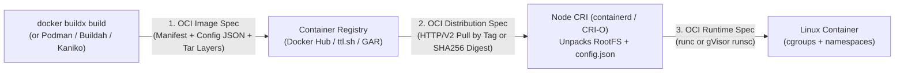
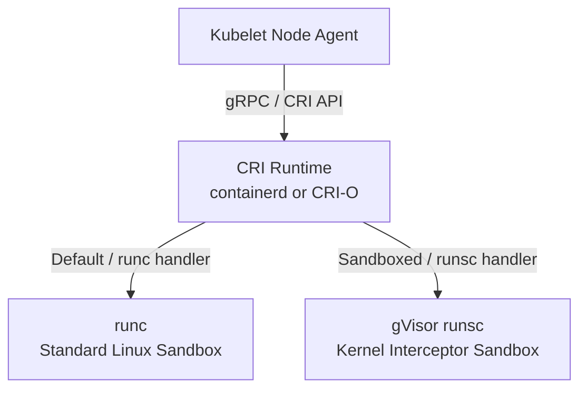

# Section 6: OCI Image Building, Registries, and Container Runtime Configuration

Welcome to Section 6 of the Kubernetes Scaling Workshop! 

This section covers critical **CKAD** syllabus areas: **container design, image building, registry usage, deployment security (digests), and container runtimes (RuntimeClasses)**.

In this guide, we will walk through:
1.  Building a secure, tiny container image using **Docker Multi-Stage Builds**, targeting the **x86_64 (`amd64`)** CPUs that cloud worker nodes use.
2.  Pushing container images to a registry (**ttl.sh**, **Docker Hub**, or your cloud's registry) and pulling private images with an **`imagePullSecret`**.
3.  Deploying pods using **mutable tags** versus **immutable SHA256 content digests** to guarantee build reproducibility.
4.  Understanding the **Container Runtime Interface (CRI)** and declaring sandboxed runtimes using **`RuntimeClass`** resources.

> [!NOTE]
> Two different things are called "OCI". An **OCI image** follows the *Open Container Initiative* image standard (every Docker image does). **OCI Container Registry (OCIR)**, in the optional Oracle path, is *Oracle Cloud Infrastructure*'s registry. Same letters, unrelated organizations.

> [!IMPORTANT]
> This section needs **Docker Desktop** (or another Docker engine with `buildx`) installed on your laptop.

---

## 📦 Module 1: Docker & OCI Standards, Multi-Stage Builds, and Image Optimization

When deploying applications to Kubernetes, your cluster nodes do **not** run Docker Desktop—they run a lightweight **OCI-compliant container runtime** such as `containerd` or `CRI-O`. Yet every image you build with `docker build` runs seamlessly on Kubernetes. Why? Because of the **Open Container Initiative (OCI)** standards.

### 1.1 Understanding Docker and OCI Container Standards
The **Open Container Initiative (OCI)** (under the Linux Foundation) defines three vendor-neutral specifications that decouple *building* containers from *storing* and *running* them:



1.  **OCI Image Specification**: Defines what a container image actually is on disk—not a single monolithic VM file, but a **JSON Manifest** pointing to an **Image Configuration JSON** (`Architecture`, `Env`, `Cmd`, `User`) and an ordered stack of **read-only `.tar.gz` filesystem layers** addressed by their `sha256:` content hash.
2.  **OCI Distribution Specification**: Standardizes the HTTP API (`/v2/...`) for pushing and pulling image layers and manifests between any client (`docker`, `crane`, `containerd`) and any registry (Docker Hub, `ttl.sh`, Google Artifact Registry, GHCR).
3.  **OCI Runtime Specification**: Defines how a low-level runtime (`runc` by default, or `runsc` for gVisor in Module 4) takes an unpacked filesystem bundle + `config.json` and asks the Linux kernel to spawn an isolated process.

---

### 1.2 Creating & Optimizing Docker Images (Multi-Stage Builds)
When building images for Kubernetes, **size, layer caching, and security** directly impact production reliability:
*   **Large images** slow down Pod autoscaling and rollouts because nodes must download gigabytes over the network on every cache miss.
*   **Images containing compilers, package managers (`apk`/`apt`), or shells** expand the attack surface if a container is compromised.
*   **Running as `root` (UID 0)** violates Kubernetes `restricted` Pod Security Standards.

#### 5 Core Image Optimization Rules for CKAD:
1.  **Use Multi-Stage Builds**:
    *   **Stage 1 (`builder`)**: Uses a full SDK image (`golang:1.22-alpine`, ~800 MB) with compilers and build tools to compile your code.
    *   **Stage 2 (runtime)**: Starts from a minimal base (`alpine:3.19` at ~7 MB, or `gcr.io/distroless/static:nonroot` / `scratch` at ~0–2 MB) and copies **only** the compiled artifact (`COPY --from=builder`). All compilers and source code are discarded!
2.  **Order Layers from Least-Frequently Changed to Most-Frequently Changed**:
    *   Docker caches each instruction (`FROM`, `RUN`, `COPY`) as an immutable OCI layer. If a layer changes, **every layer after it is invalidated and rebuilt**.
    *   Always copy dependency manifests (`package.json`, `go.mod`, `requirements.txt`) and install dependencies *before* copying application source code (`COPY . .`).
3.  **Always Add a [`.dockerignore`](app/.dockerignore) File**:
    *   Prevents `.git/`, local secrets, markdown docs, or local build artifacts from being sent into the Docker build context or accidentally baked into an image layer.
4.  **Strip Debug Symbols & Combine `RUN` Cleanup**:
    *   In Go, `-ldflags="-w -s"` strips DWARF debug tables (shrinking the binary by ~30%). When installing OS packages in a `RUN` step, clean the package cache in the **same** `RUN` layer (e.g., `apk add --no-cache ...` or `apt-get update && apt-get install -y ... && rm -rf /var/lib/apt/lists/*`), because deleting files in a *later* `RUN` layer does not shrink earlier layers!
5.  **Run as a Non-Root Numeric UID (`USER 65532:65532`)**:
    *   Using a numeric UID (instead of a username string like `USER appuser`) allows Kubernetes `securityContext.runAsNonRoot: true` to verify the container is non-root without needing to parse `/etc/passwd`.

---

### 1.3 Reviewing the Application, `.dockerignore`, and `Dockerfile`
We will build a Go web application. Go compiles to a single static executable binary, making it ideal for multi-stage builds.

1.  Review the application source code in [main.go](app/main.go) and the context exclusions in [.dockerignore](app/.dockerignore).
2.  Review the optimized multi-stage [Dockerfile](app/Dockerfile):

```dockerfile
# --- Stage 1: Build the static Go binary ---
FROM --platform=$BUILDPLATFORM golang:1.22-alpine AS builder
ARG TARGETOS
ARG TARGETARCH
WORKDIR /build
COPY main.go .
# Compile the binary as fully static (disable CGO) and strip debug symbols (-w -s)
RUN CGO_ENABLED=0 GOOS=${TARGETOS:-linux} GOARCH=${TARGETARCH} go build -ldflags="-w -s" -o app main.go

# --- Stage 2: Deploy the binary in a minimal runtime environment ---
FROM alpine:3.19
RUN adduser -D -u 65532 appuser
WORKDIR /app
COPY --from=builder /build/app .
USER 65532:65532
EXPOSE 8080
CMD ["./app"]
```

> [!TIP]
> The compile command uses `CGO_ENABLED=0`. This tells Go to build a completely self-contained binary with no dynamic linking to C libraries (`glibc`/`musl`), allowing the binary to run on any minimal filesystem—even an empty `FROM scratch` image!

> [!TIP]
> `--platform=$BUILDPLATFORM` plus `GOARCH=${TARGETARCH}` is the standard **cross-compile** pattern. The Go compiler runs natively on your laptop's CPU and emits a binary for whichever CPU you ask Docker to target — no slow QEMU emulation.

---

### 1.4 Building and Inspecting the OCI Image Locally
Workshop worker nodes are **x86_64** (GKE `e2`, OKE `E5`). An image only runs on the CPU architecture it was built for, so always build for `linux/amd64`.

> [!IMPORTANT]
> Make sure you are in the `section 6` directory before running the build, and pass `app` (or `cd app` first) as the build context directory—otherwise Docker won't find the `Dockerfile` and the build will fail with `failed to read dockerfile: open Dockerfile: no such file or directory`.

From the `section 6` directory, build the image using the `app/` folder as the build context:

```bash
# If you are at the repo root or in section 5, move into section 6 first:
# cd "section 6"

docker buildx build --platform linux/amd64 -t ckad-app:1.0 --load app
```

*(Alternatively, if you `cd app` first, run `docker buildx build --platform linux/amd64 -t ckad-app:1.0 --load .`—just remember to `cd ..` back to `section 6` before applying `manifests/` in Module 3!)*

**Inspect the resulting OCI image size, layers, and metadata:**
```bash
# 1. Check total image size (~12 MB vs ~800 MB for the builder stage!)
docker images ckad-app:1.0

# 2. Inspect the OCI layers that make up the final runtime stage
docker history ckad-app:1.0

# 3. Inspect the OCI Image Config JSON (Architecture, non-root User, and RootFS layer SHA256 digests)
docker image inspect ckad-app:1.0 --format 'Arch={{.Architecture}} User={{.Config.User}} Layers={{json .RootFS.Layers}}'
```

> [!WARNING]
> **Apple Silicon (M1/M2/M3/M4) Macs** build `arm64` images by default. Without `--platform linux/amd64`, the Pod crashes immediately with **`exec format error`** in `kubectl logs`. Intel/AMD laptops build `amd64` already, but use the flag anyway so the command works for everyone.

---

## 🚀 Module 2: Tagging and Pushing to Registries

To run your image in Kubernetes, the nodes have to pull it from a **registry**. Any registry works. Pick one:

| Option | Account needed | Best for |
|---|---|---|
| **ttl.sh** (2.1) | None | The workshop: anonymous and public, images expire automatically |
| **Docker Hub** (2.2) | Free Docker ID | Keeping your image |
| **Your cloud's registry** (2.4) | Cloud account | Private images (Artifact Registry, OCIR, ECR, ...) |

### 2.1 Push to ttl.sh (no account, recommended for the workshop)

[ttl.sh](https://ttl.sh) is an anonymous registry. The **tag is the lifetime**: `:1h`, `:2h`, up to `:24h`. Image names are public, so pick something unique:

```bash
export IMAGE=ttl.sh/ckad-app-$(whoami)-$RANDOM    # e.g. ttl.sh/ckad-app-jsmith-4821
docker tag ckad-app:1.0 $IMAGE:2h
docker push $IMAGE:2h
echo $IMAGE                                         # keep this, you'll need it below
```

> [!WARNING]
> Anyone who knows the name can pull a ttl.sh image. Never push anything secret there.

---

### 2.2 Push to Docker Hub (optional)

1.  Log in: `docker login`
2.  Tag and push:
    ```bash
    docker tag ckad-app:1.0 YOUR_DOCKER_USERNAME/ckad-app:1.0
    docker push YOUR_DOCKER_USERNAME/ckad-app:1.0
    ```
    *Public repositories need no extra Kubernetes setup. Private ones need 2.3.*

---

### 2.3 Pulling Private Images: `imagePullSecrets` (CKAD skill)

If the repository is private, the **nodes** need credentials too. Store them in a `docker-registry` Secret in your namespace:
```bash
# <registry> is e.g. docker.io, us-central1-docker.pkg.dev, iad.ocir.io
kubectl create secret docker-registry regcred \
  --docker-server=<registry> \
  --docker-username=<user> \
  --docker-password='<token-or-password>'
```
Then reference it in the Pod spec:
```yaml
spec:
  imagePullSecrets:
  - name: regcred
```
Without it, private images sit in **`ImagePullBackOff`**. Check `kubectl describe pod` for `401 Unauthorized` or `denied`. (ttl.sh and public Docker Hub images don't need this.)

---

### 2.4 Your Cloud's Registry (optional)

<details>
<summary><b>Oracle OKE path: OCI Container Registry (OCIR)</b></summary>

**OCIR** is Oracle Cloud's private registry. These steps assume you built your own OKE cluster with the Section 3 Terraform and the OCI CLI.

Set a few shell variables first (run from `section 6/app`):
```bash
export NAME=$(terraform -chdir="../../section 3/terraform" output -raw cluster_name)          # e.g. ckad-jsmith
export COMPARTMENT=$(terraform -chdir="../../section 3/terraform" output -raw compartment_ocid) # YOUR compartment
export NAMESPACE=$(oci os ns get --query data --raw-output)
export REGISTRY=iad.ocir.io                  # OCIR endpoint for us-ashburn-1
```

1. Create a private repository **inside your own compartment**. If you skip this, OCIR tries the root compartment and the push fails with `denied`:
   ```bash
   oci artifacts container repository create --compartment-id "$COMPARTMENT" --display-name "$NAME/ckad-app" --is-public false
   ```
2. Create an auth token, which is Docker's password for OCIR. Copy it now: it's shown only once.
   ```bash
   export USER_OCID=$(grep -m1 '^user=' ~/.oci/config | cut -d= -f2)
   oci iam auth-token create --user-id "$USER_OCID" --description "ckad docker" --query data.token --raw-output
   ```
3. Log in, tag and push:
   ```bash
   docker login $REGISTRY -u "$NAMESPACE/you@example.com"     # password: the auth token
   export IMAGE=$REGISTRY/$NAMESPACE/$NAME/ckad-app
   docker tag ckad-app:1.0 $IMAGE:1.0 && docker push $IMAGE:1.0
   ```
4. Create the pull secret (2.3) with `--docker-server=$REGISTRY --docker-username="$NAMESPACE/you@example.com"`, then add `imagePullSecrets` to the Pod manifests.

To delete the repository afterwards:
```bash
oci artifacts container repository list --compartment-id "$COMPARTMENT" --display-name "$NAME/ckad-app" --query 'data.items[0].id' --raw-output \
  | xargs -I{} oci artifacts container repository delete --repository-id {} --force
```
</details>

<details>
<summary><b>GKE path: Artifact Registry</b> (your own project only; workshop accounts have no Google Cloud access)</summary>

```bash
gcloud artifacts repositories create ckad --repository-format=docker --location=us-central1
gcloud auth configure-docker us-central1-docker.pkg.dev
export IMAGE=us-central1-docker.pkg.dev/$(gcloud config get-value project)/ckad/ckad-app
docker tag ckad-app:1.0 $IMAGE:1.0 && docker push $IMAGE:1.0
```
GKE nodes in the same project can pull without a Secret.
</details>

---

## 🔒 Module 3: Mutable Tags vs. Immutable Content Digests

When deploying Pods in Kubernetes, how you reference the image affects security and reproducibility.

### 3.1 Mutable Tags
A tag like `:1.0` or `:latest` is **mutable** (can change). If an developer pushes an updated container image using the same tag (`:1.0`), the registry updates the pointer.
*   **The Risk**: If your Kubernetes cluster nodes pull this image, some nodes may run the old version (if the image was cached locally and `imagePullPolicy` is set to `IfNotPresent`) while new nodes pull the new version. This leads to **deployment drift**.
*   **The Security Threat**: If an attacker compromises your registry, they could overwrite your tag with malicious code.

---

### 3.2 Immutable Content Digests (SHA256)
Every image build creates a unique cryptographic hash of its filesystem layers, known as a **digest**. The digest looks like `sha256:7ebe7d...` and is completely **immutable**. If a single bit in the container filesystem changes, the hash changes.

#### 1. Retrieve Your Image Digest
After pushing, ask Docker for the digest the registry recorded:
```bash
docker inspect --format='{{index .RepoDigests 0}}' $IMAGE:2h      # use your tag (e.g. :1.0 for Docker Hub/OCIR)
```
*Every registry's web UI shows the same `sha256:` digest next to each tag.*

#### 2. Deploy Using a Tag (Mutable)
Open [pod-tag.yaml](manifests/pod-tag.yaml) and set `image:` to your image **by tag** (e.g. `ttl.sh/ckad-app-jsmith-4821:2h`). Deploy the pod:
```bash
kubectl apply -f manifests/pod-tag.yaml
```

#### 3. Deploy Using a Digest (Immutable)
Open [pod-digest.yaml](manifests/pod-digest.yaml). Update the image line, referencing the image name appended with `@sha256:<your-hash>`:
```yaml
spec:
  containers:
  - name: ckad-app
    image: ttl.sh/ckad-app-jsmith-4821@sha256:e3b0c44298fc1c149afbf4c8996fb92427ae41e4649b934ca495991b7852b855
```
Deploy the pod:
```bash
kubectl apply -f manifests/pod-digest.yaml
```

#### 4. Verification
Inspect the running pods:
```bash
kubectl get pod ckad-app-tag -o jsonpath='{.status.containerStatuses[0].imageID}'
```
*Observe that even though you deployed `ckad-app-tag` by **tag**, the runtime records the immutable digest (`<repository>@sha256:...`) it actually pulled. That's what is really running.*

---

### 3.3 Image Pull Policies

The **`imagePullPolicy`** field in your Pod specification determines when the node's container runtime (`containerd` or `CRI-O`) should pull the image from the registry versus using a locally cached image.

There are three available policies:

| Policy | Behavior | Default When |
| :--- | :--- | :--- |
| **`Always`** | Kubernetes checks the registry every time the Pod starts. It validates the registry's hash with the local cache; if a newer image exists, it downloads it. | Tag is `:latest` or omitted. |
| **`IfNotPresent`** | Kubernetes checks the local cache first. If the image is already on the node, it runs it immediately. It **only** pulls from the registry if the image is missing. | Tag is specific (e.g., `:1.0` or `:v2`). |
| **`Never`** | Kubernetes will **never** query the registry. It assumes the image is already pre-loaded on the node VM. | N/A |

#### 3.3.1 Setting the Policy in YAML
You define this under the container spec:
```yaml
spec:
  containers:
  - name: ckad-app
    image: ttl.sh/ckad-app-jsmith-4821:2h
    imagePullPolicy: Always # Options: Always, IfNotPresent, Never
```

#### 3.3.2 Hands-On: Testing the Policies

##### Test 1: Caching Behavior with `IfNotPresent`
1. Deploy a pod with a specific tag (your `$IMAGE:2h`, or `:1.0` on Docker Hub). By default, Kubernetes interprets this as `IfNotPresent`.
2. Delete and recreate the pod. Observe the start time is near-instant because the node skipped downloading the image layers from the registry.

##### Test 2: Overwriting Tags (The Danger of Mutable Tags + `IfNotPresent`)
1. Re-build your application with a slight change (e.g. edit `app/main.go` to print "Hello v2" instead) and push it under the **same tag**. Remember `--platform linux/amd64` and to point the build context at `app` (or run from inside `app/` with `.`):
   ```bash
   docker buildx build --platform linux/amd64 -t $IMAGE:2h --push app
   ```
2. Re-deploy the Pod. Because the node already has that tag cached, and its policy is `IfNotPresent`, the node **will not pull** the new image. Your Pod will run the old "v1" code, demonstrating the danger of tag mutation.

> [!NOTE]
> Your cluster has several nodes. If the new Pod lands on a node that has never cached the tag, it pulls the new image, and you've reproduced **deployment drift** for real. Run `kubectl get pod -o wide` to see which node it chose. To force the same node for the demo, add `nodeName: <node>` under `spec`.

##### Test 3: Solving Drift with `Always`
1. Re-deploy the Pod, but set `imagePullPolicy: Always` in the spec.
2. Even though the node has the tag cached, the runtime queries the registry, sees that the tag's SHA256 digest in the registry is different, pulls the new image layers, and runs the new code.

##### Test 4: Testing `Never` (Failing when not cached)
1. Deploy a Pod with a non-existent image tag (e.g. `:99.0`) and set `imagePullPolicy: Never`.
2. Inspect the Pod state:
   ```bash
   kubectl get pods
   ```
   *Observe the Pod fails immediately with the status **`ErrImageNeverPull`** because the image does not exist locally on the node VM.*

---

## 🛡️ Module 4: Kubernetes Runtime Class & Container Runtimes (CRI)

The **Container Runtime Interface (CRI)** is the API standard that allows the Kubernetes `kubelet` agent on each node to communicate with the active container runtime (like `containerd`, or `CRI-O` on your OKE nodes).



By default, the runtime runs pods using **`runc`**, which isolates containers using standard Linux Namespaces and Cgroups. However, all containers on the node share the same host Linux Kernel. If a container breaks out (privilege escalation), it can compromise the whole node.

For untrusted workloads (e.g. user-submitted code in a workshop), we use sandboxed runtimes like **gVisor (`runsc`)** or **Kata Containers** (micro-VMs) to isolate the container from the host kernel.

---

### 4.1 Which Runtimes Does This Cluster Offer?

A **RuntimeClass** maps a name you use in Pod specs to a runtime **handler** configured on the nodes. RuntimeClasses are cluster-scoped, so admins create them. You *use* them.

```bash
kubectl get runtimeclass
kubectl describe runtimeclass gvisor
```

| Cluster | What you'll see |
|---|---|
| **Shared workshop cluster (GKE)** | `gvisor` (GKE Sandbox) with a **node selector** `sandbox.gke.io/runtime: gvisor`, plus a dedicated gVisor node pool. Everything below works. |
| **Your own GKE cluster** | `gvisor` exists, but you need a sandbox node pool (`enable_gvisor_pool = true` in the Section 3 GKE Terraform). |
| **Oracle OKE / most other clusters** | Probably nothing. An admin has to install gVisor (`runsc`) on the nodes and create the RuntimeClass. [admin/runtimeclass.yaml](manifests/admin/runtimeclass.yaml) is an example. |

---

### 4.2 Deploying a Pod with a Custom Runtime

To run your container inside the sandbox, add **`runtimeClassName`** to the Pod spec. That one line is all the CKAD exam expects from you.

1.  Review and deploy [pod-runtimeclass.yaml](manifests/pod-runtimeclass.yaml):
    ```bash
    kubectl apply -f manifests/pod-runtimeclass.yaml
    ```
2.  Check where it landed:
    ```bash
    kubectl get pod nginx-gvisor -o wide
    kubectl get pod nginx-gvisor -o jsonpath='{.spec.tolerations}'; echo
    ```
    *On the workshop cluster it runs on a `...-gvisor-...` node. Notice the toleration you never wrote: the RuntimeClass's `scheduling` section added it, so the Pod can only land on sandbox nodes.*

> [!WARNING]
> **No gVisor on your cluster?** Then one of these happens:
> - the Pod is rejected (`RuntimeClass "gvisor" not found`);
> - it stays `Pending` (no node matches the RuntimeClass's node selector);
> - it hangs in `ContainerCreating` with *`no runtime for "gvisor" is configured`*.
>
> That's the lesson: a **RuntimeClass is only a pointer**. Nothing runs until an admin installs the matching handler on the nodes.

---

### 4.3 Verifying Sandboxed Isolation

gVisor intercepts system calls and runs its own user-space kernel (**Sentry**), so the container sees *gVisor's* kernel, not the node's.

```bash
kubectl exec nginx-gvisor -- uname -r     # e.g. 4.19.0-gvisor
kubectl exec nginx-gvisor -- dmesg        # gVisor's own boot log
```
*Expected `dmesg` output starts with `[ 0.000000] Starting gVisor...`, followed by a few joke lines (gVisor's boot log is famously whimsical).*

Compare with a normal Pod on a regular node:
```bash
kubectl run plain --image=docker.io/library/busybox:1.36 --restart=Never -- sleep 300
kubectl exec plain -- uname -r            # the node's real kernel, e.g. 6.x
kubectl exec plain -- dmesg               # "Operation not permitted": the host kernel log is protected
kubectl delete pod plain
```

---

## 🧹 Cleaning Up

After completing this section, clean up:

```bash
kubectl delete -f manifests/ --ignore-not-found     # admin/ is not included (not recursive)
kubectl delete secret regcred --ignore-not-found
```

ttl.sh images delete themselves when their tag's time runs out. Docker Hub and cloud-registry images stay until you delete them.
