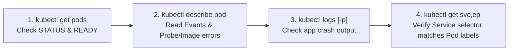

# Section 7: Application Observability and Maintenance

Welcome to Section 7! This standalone lab covers the **CKAD Application Observability and Maintenance (15%)** domain—monitoring, logging, health-checking, and troubleshooting applications in production.

> [!NOTE]
> **Self-Contained Lab:** This section does not depend on resources from earlier sections. You only need `kubectl` pointed at your workshop `kubeconfig`.

In this section, you will practice:
1.  **Health Checks (Probes)**: Configuring and testing **Startup Probes**, **Readiness Probes**, and **Liveness Probes** (`httpGet`, `exec`, `tcpSocket`).
2.  **Accessing Application Logs**: Inspecting single-container logs, multi-container logs (`-c`), real-time streams (`-f`), timestamps (`--timestamps`), and **previous crashed container logs (`--previous` / `-p`)**.
3.  **Monitoring Resource Usage & Performance**: Using `kubectl top nodes` and `kubectl top pods --containers` (powered by Metrics Server) to spot CPU and memory bottlenecks.
4.  **Collecting Metrics & Prometheus Basics**: Understanding the **Prometheus exposition format** (`counter`, `gauge`, `histogram`), standard `prometheus.io/*` Pod annotations, and scraping a live `/metrics` endpoint.
5.  **Debugging Application Issues (Hands-On Challenge)**: Diagnosing and fixing a broken multi-tier deployment (`ImagePullBackOff`, failing Readiness Probe, and mismatched Service selector / empty Endpoints).

---

## 🩺 Module 1: Health Checks (Startup, Readiness & Liveness Probes)

By default, Kubernetes only knows if a container's main process (`PID 1`) is still running. However, a process can be running yet deadlocked, still booting up, or temporarily unable to reach its database. **Probes** let the node's `kubelet` actively check your application's real health.

### 1.1 The Three Probe Types

```mermaid
sequenceDiagram
    participant K as kubelet
    participant P as Container
    participant S as Service Endpoints

    Note over K,P: Phase 1: Startup Probe (runs first; blocks other probes until it succeeds)
    K->>P: startupProbe (httpGet /:80)
    P-->>K: 200 OK (Boot finished!)

    Note over K,S: Phase 2: Readiness & Liveness run continuously in parallel
    K->>P: readinessProbe (exec: cat /tmp/ready)
    P-->>K: Exit 0 -> Add Pod IP to Service Endpoints
    K->>P: livenessProbe (httpGet /:80)
    P-->>K: 200 OK -> Keep container running

    Note over K,S: What happens on failure?
    K->>P: readinessProbe fails (Exit 1)
    K->>S: Remove Pod IP from Service (NO container restart!)
    K->>P: livenessProbe fails (500 / timeout)
    K->>P: Kill & restart container (RESTARTS +1)
```

| Probe Type | Purpose | What happens when it fails? | When to use |
| :--- | :--- | :--- | :--- |
| **`startupProbe`** | Verifies the application has finished its initial boot sequence. | **Disables** liveness and readiness checks until it succeeds. If it exceeds `failureThreshold × periodSeconds`, the container is killed and restarted. | Slow-starting legacy or JVM/ML apps that take 10–120 seconds to boot so `livenessProbe` doesn't kill them mid-startup. |
| **`readinessProbe`** | Checks if the container is ready to accept live user traffic *right now*. | The Pod stays `Running` (**not restarted**), but its IP is **removed from Service `Endpoints`** so no client requests are sent to it. | Waiting for caches to warm up, or temporarily shedding traffic when a downstream dependency is overloaded. |
| **`livenessProbe`** | Checks if the container process is healthy or deadlocked/frozen. | The `kubelet` **kills and restarts** the container (`RESTARTS` increments). | Recovering from application deadlocks or unrecoverable internal states. |

#### Three Probe Mechanisms (used by all 3 probe types):
1.  **`httpGet`**: Sends an HTTP GET request to `path` and `port` (`200–399` = success).
2.  **`exec`**: Runs a command inside the container (`exit 0` = success).
3.  **`tcpSocket`**: Attempts to open a TCP connection to `port` (connection established = success).

---

### 1.2 Hands-On: Testing Startup, Readiness & Liveness Probes

Review [manifests/pod-probes.yaml](manifests/pod-probes.yaml). It deploys a Pod (`probes-demo`) and a Service (`probes-svc`) that uses **all three** probes:
*   The container sleeps for **6 seconds** on boot to simulate slow initialization, then creates `/tmp/ready` and starts `nginx`.
*   **`startupProbe`** checks `httpGet /` on port `80` every 2 seconds (up to 15 times = 30s budget).
*   **`readinessProbe`** runs `cat /tmp/ready` every 3 seconds.
*   **`livenessProbe`** checks `httpGet /` on port `80` every 5 seconds.

1.  **Apply the manifest and watch the startup sequence:**
    ```bash
    cd "section 7"
    kubectl apply -f manifests/pod-probes.yaml
    kubectl get pod probes-demo
    ```
    *For the first ~6 seconds, `STATUS` is `Running` but `READY` is `0/1` while `startupProbe` waits for Nginx to boot.*

2.  **Wait for the Pod to become Ready and check the Service Endpoints:**
    ```bash
    kubectl wait --for=condition=Ready pod/probes-demo --timeout=60s
    kubectl get endpoints probes-svc
    ```
    *Notice the Pod's IP is listed under `ENDPOINTS` because both `startupProbe` and `readinessProbe` succeeded!*

3.  **Trigger a Readiness Failure (Traffic Shedding without Restart):**
    Remove `/tmp/ready` inside the container so the `readinessProbe` fails while Nginx keeps running:
    ```bash
    kubectl exec probes-demo -- rm /tmp/ready
    sleep 4
    kubectl get pod probes-demo
    kubectl get endpoints probes-svc
    ```
    *Look closely at the output:*
    * `probes-demo` shows `READY 0/1`, `STATUS Running`, and **`RESTARTS 0`** (it was **not** restarted!).
    * `kubectl get endpoints probes-svc` shows `<none>`—Kubernetes automatically pulled the Pod out of the Service load balancer!

4.  **Restore Readiness:**
    Recreate `/tmp/ready` and watch the Pod rejoin the Service within 3 seconds:
    ```bash
    kubectl exec probes-demo -- touch /tmp/ready
    sleep 4
    kubectl get pod probes-demo
    kubectl get endpoints probes-svc
    ```
    *`READY` returns to `1/1` and the Pod IP is back in `endpoints/probes-svc`!*

---

## 📜 Module 2: Accessing Application Logs (Pod, Container & Previous Crash Logs)

When an application misbehaves on the CKAD exam, `kubectl logs` is your first stop.

### 2.1 Hands-On: Multi-Container & Previous Crash Logs (`--previous`)

Review [manifests/pod-logs.yaml](manifests/pod-logs.yaml). It runs two containers inside `log-tracker`:
*   `payment-api`: Continuously logs order events to `stdout`.
*   `flaky-worker`: Starts up, runs for 5 seconds, prints a fatal error to `stderr`, and crashes with `exit 1`.

1.  **Deploy `pod-logs.yaml`:**
    ```bash
    kubectl apply -f manifests/pod-logs.yaml
    sleep 8
    kubectl get pod log-tracker
    ```
    *You will see `READY 1/2` (or `CrashLoopBackOff`) with `RESTARTS` incrementing as `flaky-worker` crashes and restarts.*

2.  **Inspect logs from the healthy `payment-api` container:**
    Because the Pod has multiple containers, pass `-c <container-name>`:
    ```bash
    # Show the last 5 lines with ISO-8601 timestamps
    kubectl logs log-tracker -c payment-api --tail=5 --timestamps

    # Filter logs from the last 1 minute
    kubectl logs log-tracker -c payment-api --since=1m
    ```

3.  **Inspect the crashed `flaky-worker` container using `--previous` (`-p`):**
    When a container restarts, `kubectl logs` shows the *newly restarted* instance (which may have only printed `[BOOT] flaky-worker starting up...` so far!). To see **why the previous instance crashed**, always use `--previous` (or `-p`):
    ```bash
    kubectl logs log-tracker -c flaky-worker --previous
    ```
    *Output:*
    ```text
    [BOOT] flaky-worker starting up...
    [FATAL] flaky-worker encountered unhandled panic: database connection timeout!
    ```
    > [!TIP]
    > **CKAD Exam Essential:** Whenever you see a Pod with `RESTARTS > 0` or `CrashLoopBackOff`, immediately run `kubectl logs <pod> [-c <container>] -p` to read the crash output from the terminated container!

---

## 📊 Module 3: Monitoring Resource Usage & Performance (`kubectl top`)

Kubernetes clusters run **Metrics Server**, a lightweight in-memory aggregator that collects live CPU and memory consumption from every node's `kubelet` (via the Summary API) and exposes it through the `metrics.k8s.io` API.

### 3.1 Inspecting Node and Pod Resource Consumption

1.  **View CPU and Memory usage across cluster worker nodes:**
    ```bash
    kubectl top nodes
    ```
    *Shows live `CPU(cores)`, `CPU%`, `MEMORY(bytes)`, and `MEMORY%` for each node in the cluster.*

2.  **View CPU and Memory usage for Pods in your namespace:**
    ```bash
    kubectl top pods
    ```

3.  **Break down usage per container and sort by CPU or Memory (CKAD favorite!):**
    ```bash
    # Show individual containers inside multi-container pods
    kubectl top pod --containers

    # Sort Pods by highest memory or CPU consumption
    kubectl top pods --sort-by=memory
    kubectl top pods --sort-by=cpu
    ```

> [!NOTE]
> Newly created Pods take ~15–30 seconds before their first metric sample appears in `kubectl top pods`.

---

## 📈 Module 4: Collecting Metrics & Understanding Prometheus Basics

While `kubectl top` only tracks current CPU and RAM, production cloud-native applications expose rich **application-level metrics** (request rate, error count, latency percentiles, queue depth) using the **Prometheus** exposition format.

### 4.1 How Prometheus Works in Kubernetes
Instead of applications pushing metrics to a central server, **Prometheus uses a pull (scrape) model**:
1.  Your application exposes an HTTP endpoint (conventionally `/metrics` on its container port) returning plain-text metrics.
2.  You add standard **Prometheus discovery annotations** to your Pod metadata:
    ```yaml
    metadata:
      annotations:
        prometheus.io/scrape: "true"
        prometheus.io/port: "8080"
        prometheus.io/path: "/metrics"
    ```
3.  Prometheus discovers Pods with `prometheus.io/scrape: "true"` via the Kubernetes API and scrapes `/metrics` every 15–60 seconds.

### 4.2 The Four Core Prometheus Metric Types

| Metric Type | Behavior | Example |
| :--- | :--- | :--- |
| **`counter`** | Cumulative number that **only goes up** (or resets to 0 on restart). | `http_requests_total`, `errors_total` |
| **`gauge`** | A value that can **go up and down** at any moment. | `memory_usage_bytes`, `active_connections`, `queue_depth` |
| **`histogram`** | Samples observations (like request durations) into configurable **buckets** (`_bucket{le="..."}`), plus `_sum` and `_count`. | `http_request_duration_seconds` |
| **`summary`** | Similar to a histogram, but calculates streaming quantiles (`0.5`, `0.95`, `0.99`) on the client side. | `rpc_duration_seconds` |

---

### 4.3 Hands-On: Deploying & Scraping a Prometheus `/metrics` Endpoint

Review and apply [manifests/pod-metrics.yaml](manifests/pod-metrics.yaml):
```bash
kubectl apply -f manifests/pod-metrics.yaml
kubectl wait --for=condition=Ready pod/metrics-demo --timeout=60s
```

1.  **Verify the Prometheus scrape annotations on the Pod:**
    ```bash
    kubectl get pod metrics-demo -o jsonpath='{.metadata.annotations}'
    ```
2.  **Scrape the raw Nginx `stub_status` and Prometheus `/metrics` endpoint:**
    ```bash
    kubectl exec metrics-demo -- wget -qO- http://localhost:8080/stub_status
    kubectl exec metrics-demo -- wget -qO- http://localhost:8080/metrics
    ```
    *Look at the `/metrics` output:*
    ```text
    # HELP http_requests_total Total number of HTTP requests processed
    # TYPE http_requests_total counter
    http_requests_total{method="GET",status="200",service="order-api"} 142
    http_requests_total{method="POST",status="500",service="order-api"} 3
    # HELP memory_usage_bytes Current memory usage in bytes
    # TYPE memory_usage_bytes gauge
    memory_usage_bytes{service="order-api"} 52428800
    # HELP http_request_duration_seconds HTTP request latency histogram
    # TYPE http_request_duration_seconds histogram
    http_request_duration_seconds_bucket{le="0.05"} 120
    ...
    ```
    *Notice how dimensional labels (`{method="POST",status="500"}`) let you slice metrics by HTTP status, route, or service in PromQL!*

---

## 🛠️ Module 5: Debugging Application Issues (Hands-On Troubleshooting Lab)

On the CKAD exam, you will frequently be handed a broken Deployment or Service and asked to make it work. Use this **4-step systematic workflow** every time:



### 5.1 Deploy the Broken Application
Apply [manifests/pod-broken.yaml](manifests/pod-broken.yaml):
```bash
kubectl apply -f manifests/pod-broken.yaml
```
There are **3 distinct bugs** preventing `broken-svc` from serving traffic. Let's find and fix all 3!

---

### 5.2 Bug #1: Diagnose `ErrImagePull` / `ImagePullBackOff`
1.  Check the Pod status:
    ```bash
    kubectl get pods -l app=debug-app
    ```
    *Status shows `ErrImagePull` or `ImagePullBackOff`.*
2.  Inspect the Pod events to see why the image pull failed:
    ```bash
    kubectl describe pod -l app=debug-app | tail -n 15
    ```
    *Look at the `Events:` section:* `Failed to pull image "docker.io/library/nginx:1.25-alpin": ... not found`.
3.  **Fix Bug #1**: Update the image tag to `docker.io/library/nginx:1.25-alpine`:
    ```bash
    kubectl set image deployment/broken-app web=docker.io/library/nginx:1.25-alpine
    ```

---

### 5.3 Bug #2: Diagnose `Running` Pod Stuck at `READY 0/1`
1.  Wait a few seconds and check the Pod again:
    ```bash
    kubectl get pods -l app=debug-app
    ```
    *The new Pod is `Running`, but `READY` stays stuck at `0/1`!*
2.  Describe the Pod to see why it isn't becoming Ready:
    ```bash
    kubectl describe pod -l app=debug-app | tail -n 15
    ```
    *Look at the `Events:` section:*
    `Readiness probe failed: Get "http://10.20.x.x:8080/": dial tcp 10.20.x.x:8080: connect: connection refused`
    *Aha! Nginx listens on port **`80`**, but the `readinessProbe` is checking port **`8080`**!*
3.  **Fix Bug #2**: Patch the Deployment's `readinessProbe` port from `8080` to `80`:
    ```bash
    kubectl patch deployment broken-app --type='json' \
      -p='[{"op": "replace", "path": "/spec/template/spec/containers/0/readinessProbe/httpGet/port", "value": 80}]'
    kubectl rollout status deployment/broken-app
    ```
    *Verify the Pod now shows `READY 1/1`!*

---

### 5.4 Bug #3: Diagnose Service Routing Failure (Empty Endpoints)
1.  The Pod is `1/1 Running`, so let's test calling `broken-svc` from `probes-demo`:
    ```bash
    kubectl exec probes-demo -- wget -qO- --timeout=3 http://broken-svc
    ```
    *It fails with `can't connect to remote host: Connection refused`!*
2.  Whenever a Service fails to reach a `1/1 Ready` Pod, immediately check **`Endpoints`** and compare the Service's `Selector` against the Pod's `Labels`:
    ```bash
    kubectl get endpoints broken-svc
    kubectl describe svc broken-svc | grep Selector
    kubectl get pods -l app=debug-app --show-labels
    ```
    *Look at that:*
    * `broken-svc` has `Selector: app=wrong-label` and `Endpoints: <none>`.
    * The Pod's actual label is `app=debug-app`!
3.  **Fix Bug #3**: Patch `broken-svc` so its selector matches `app: debug-app`:
    ```bash
    kubectl patch svc broken-svc -p '{"spec":{"selector":{"app":"debug-app"}}}'
    kubectl get endpoints broken-svc
    ```
4.  **Verify the fix end-to-end:**
    ```bash
    kubectl exec probes-demo -- wget -qO- http://broken-svc | head -n 5
    ```
    *You get `<!DOCTYPE html> ... Welcome to nginx!` — all 3 bugs are resolved!*

---

## ⏳ Module 6: Understanding API Deprecations & Schema Discovery

Kubernetes evolves its APIs through three maturity stages:
1.  **Alpha (`v1alpha1`)**: Experimental, disabled by default, may be dropped without notice.
2.  **Beta (`v1beta1`, `v2beta2`)**: Well-tested and enabled by default, but schema details may change before GA. Once a resource graduates to **`v1` (Stable/GA)**, the beta API version is deprecated and removed after ~3 releases (e.g., `networking.k8s.io/v1beta1` Ingress was removed in K8s 1.22; `batch/v1beta1` CronJob was removed in K8s 1.25; `autoscaling/v2beta2` HPA was removed in K8s 1.26).
3.  **Stable / GA (`v1`, `v2`)**: Production-ready and supported long-term.

### 6.1 Hands-On: Fixing a Deprecated Manifest (`batch/v1beta1` -> `batch/v1`)

On the CKAD exam, you may be given a YAML file written for an older cluster that fails with **`no matches for kind "..." in version "..."`**. Here is the exact 3-step method to fix it without memorizing API versions:

1.  **Try applying the legacy manifest [manifests/deprecated-cronjob.yaml](manifests/deprecated-cronjob.yaml):**
    ```bash
    kubectl apply -f manifests/deprecated-cronjob.yaml
    ```
    *It fails immediately:*
    ```text
    error: resource mapping not found for name: "legacy-audit-cron" namespace: "..." from "manifests/deprecated-cronjob.yaml": no matches for kind "CronJob" in version "batch/v1beta1"
    ```

2.  **Discover the current `APIVERSION` supported by the cluster:**
    Use `kubectl api-resources` or `kubectl explain`:
    ```bash
    kubectl api-resources | grep -i cronjob
    kubectl explain cronjob
    ```
    *Look at the `APIVERSION` column (`batch/v1`) and `VERSION:` in `kubectl explain`!*

3.  **Upgrade `apiVersion: batch/v1beta1` to `apiVersion: batch/v1` and apply:**
    ```bash
    sed 's|batch/v1beta1|batch/v1|' manifests/deprecated-cronjob.yaml | kubectl apply -f -
    kubectl get cronjob legacy-audit-cron
    ```
    *The `CronJob` is created cleanly!*

---

## 🧹 Cleaning Up

Clean up all resources created in this section:
```bash
kubectl delete cronjob legacy-audit-cron --ignore-not-found
kubectl delete -f manifests/pod-broken.yaml -f manifests/pod-metrics.yaml -f manifests/pod-logs.yaml -f manifests/pod-probes.yaml --ignore-not-found
```
