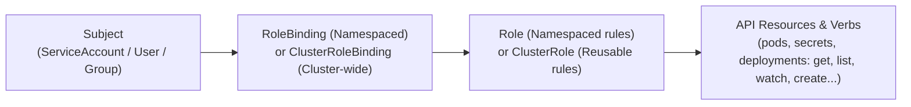
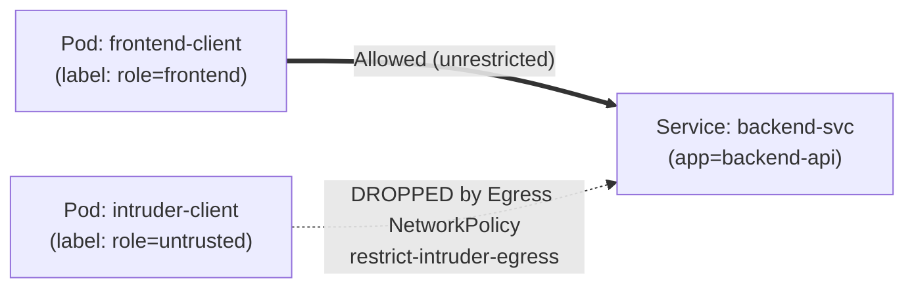

# Section 8: Application Security, RBAC & Network Policies

Welcome to Section 8! Together with [Section 5, Module 1 (ConfigMaps, Secrets, Env Vars & Volume Mounts)](../section%205/README.md#1-module-1-decoupling-configuration-configmaps--secrets), this standalone lab completes the **CKAD Application Environment, Configuration and Security (25%)** domain.

> [!NOTE]
> **Self-Contained Lab:** This section does not depend on resources from earlier sections. Everything runs inside your existing workshop namespace with your standard `kubeconfig`.

In this section, you will practice:
1.  **Pod Security Standards (PSS) & PodSecurityPolicies**: Understanding `privileged`, `baseline`, and `restricted` enforcement levels, and inspecting your namespace's active Pod Security Admission labels.
2.  **Pod & Container `SecurityContext`**: Running containers as a non-root user (`runAsNonRoot`, `runAsUser`, `fsGroup`), locking down the root filesystem (`readOnlyRootFilesystem`), dropping Linux capabilities (`drop: ["ALL"]`), and eliminating `PodSecurity` warnings.
3.  **ServiceAccounts & Role-Based Access Control (RBAC)**: Creating `ServiceAccount`s, controlling token auto-mounting (`automountServiceAccountToken`), inspecting `Role`s / `RoleBinding`s, and testing permissions with `kubectl auth can-i`.
4.  **NetworkPolicies for Application Isolation**: Enforcing zero-trust microsegmentation between Pods (`podSelector`, `namespaceSelector`, `ipBlock`, `Ingress` & `Egress` rules).

---

## 🛡️ Module 1: Pod Security Standards (PSS) & `SecurityContext`

### 1.1 From PodSecurityPolicy (PSP) to Pod Security Standards (PSS)

*   **Historical Context (`PodSecurityPolicy`)**: In older Kubernetes versions, cluster admins used `PodSecurityPolicy` objects to restrict Pod privileges. Because PSP had confusing RBAC binding semantics, it was deprecated in Kubernetes 1.21 and **removed in Kubernetes 1.25**.
*   **Modern Standard (`Pod Security Standards` + `Pod Security Admission`)**: Built directly into the Kubernetes API server and configured via simple **labels on a Namespace**:
    *   `pod-security.kubernetes.io/enforce: <level>` — **Rejects** Pods that violate the profile.
    *   `pod-security.kubernetes.io/warn: <level>` — Allows the Pod, but prints a **user-facing warning** in `kubectl`.
    *   `pod-security.kubernetes.io/audit: <level>` — Records an audit log event if violated.

#### The Three Pod Security Standard Levels:

| Profile | Description | Key Restrictions |
| :--- | :--- | :--- |
| **`privileged`** | Unrestricted. | None (used only for trusted system Daemons like CNI plugins or storage drivers). |
| **`baseline`** | Minimally restrictive; prevents known privilege escalations while allowing most default container images to run out-of-the-box. | Blocks `privileged: true`, `hostNetwork`, `hostPID`, `hostIPC`, `hostPath` volumes, and adding dangerous Linux capabilities. |
| **`restricted`** | Heavily hardened following current container security best practices. | Everything in `baseline` **plus**: requires `runAsNonRoot: true`, `allowPrivilegeEscalation: false`, `capabilities.drop: ["ALL"]`, and a `seccompProfile` (`RuntimeDefault` or `Localhost`). |

---

### 1.2 Hands-On: Inspecting Your Namespace's Pod Security Labels

1.  Check the labels on your workshop namespace:
    ```bash
    cd "section 8"
    NS=$(kubectl config view --minify -o jsonpath='{..namespace}')
    kubectl get namespace $NS --show-labels
    ```
    *Look at the labels on your namespace:*
    *   `pod-security.kubernetes.io/enforce=baseline`
    *   `pod-security.kubernetes.io/warn=restricted`
    *That explains why every time you deployed a standard Pod in earlier sections, Kubernetes allowed it (`baseline`) while printing `Warning: would violate PodSecurity "restricted:latest"`!*

2.  **Test the `baseline` Enforcement Guardrail:**
    Try to deploy [manifests/pod-privileged-denied.yaml](manifests/pod-privileged-denied.yaml), which sets `securityContext.privileged: true`:
    ```bash
    kubectl apply -f manifests/pod-privileged-denied.yaml
    ```
    *The API server immediately blocks the Pod:*
    ```text
    Error from server (Forbidden): error when creating "manifests/pod-privileged-denied.yaml": pods "pod-privileged-denied" is forbidden: violates PodSecurity "baseline:latest": privileged (container "app" must not set securityContext.privileged=true)
    ```

---

### 1.3 Hands-On: Hardening a Pod with `SecurityContext` (`restricted` Compliant)

A **`securityContext`** can be defined at two levels in a Pod YAML:
*   **Pod-level (`spec.securityContext`)**: Applies default UID/GID (`runAsUser`, `runAsGroup`, `runAsNonRoot`), Seccomp profile, and volume group ownership (`fsGroup`) across all containers in the Pod.
*   **Container-level (`spec.containers[*].securityContext`)**: Applies container-specific settings like `allowPrivilegeEscalation`, `readOnlyRootFilesystem`, and Linux `capabilities` (overrides Pod-level settings if both set `runAsUser`).

1.  Review and apply [manifests/pod-securitycontext.yaml](manifests/pod-securitycontext.yaml):
    ```bash
    kubectl apply -f manifests/pod-securitycontext.yaml
    ```
    *Notice there is **zero `PodSecurity` warning**! Because `pod-hardened` sets `runAsNonRoot: true`, `allowPrivilegeEscalation: false`, `capabilities.drop: ["ALL"]`, and `seccompProfile.type: RuntimeDefault`, it passes `restricted:latest` cleanly.*

2.  **Verify the non-root UID, GID, and `fsGroup` inside the container:**
    ```bash
    kubectl wait --for=condition=Ready pod/pod-hardened --timeout=60s
    kubectl exec pod-hardened -- id
    ```
    *Output:* `uid=65532(65532) gid=65532(65532) groups=65532(65532),2000`
    *(Notice supplemental group `2000` from `fsGroup: 2000`!)*

3.  **Verify `readOnlyRootFilesystem: true` vs. Mounted Volume:**
    Try writing a file to `/tmp` on the root filesystem vs. `/data` (an `emptyDir` volume owned by `fsGroup: 2000`):
    ```bash
    # 1. Writing to the root filesystem fails (Read-only file system!):
    kubectl exec pod-hardened -- touch /tmp/hack.sh

    # 2. Reading & writing to the mounted /data volume works:
    kubectl exec pod-hardened -- cat /data/status.txt
    kubectl exec pod-hardened -- ls -ln /data/status.txt
    ```
    *Look at the group column of `ls -ln`: the file is owned by UID `65532` and GID **`2000`** (`fsGroup`)!*

---

## 🔑 Module 2: ServiceAccounts & Role-Based Access Control (RBAC)

In Kubernetes, human users and automated processes authenticate differently, but both are authorized using **RBAC**.

### 2.1 How RBAC Works (`Role`, `ClusterRole`, `RoleBinding`, `ClusterRoleBinding`)



| Object | Scope | Purpose |
| :--- | :--- | :--- |
| **`ServiceAccount`** | Namespaced | An identity for Pods/processes running inside a namespace. Every namespace has a `default` ServiceAccount, or you can create dedicated ones per application. |
| **`Role`** | Namespaced | Defines a set of allowed **verbs** (`get`, `list`, `watch`, `create`, `delete`) on **resources** (`pods`, `configmaps`, `secrets`) within a single namespace. |
| **`ClusterRole`** | Cluster-scoped | Defines allowed verbs on cluster-scoped resources (`nodes`, `persistentvolumes`) **OR** acts as a reusable template (like the built-in `view`, `edit`, and `admin` ClusterRoles) that can be bound inside individual namespaces. |
| **`RoleBinding`** | Namespaced | Grants the permissions of a `Role` (or a `ClusterRole`) to a `ServiceAccount`/User **within that namespace only**. |
| **`ClusterRoleBinding`** | Cluster-scoped | Grants the permissions of a `ClusterRole` across the **entire cluster**. |

---

### 2.2 Hands-On: Auditing Permissions with `kubectl auth can-i` & ServiceAccounts

1.  **Inspect the `ServiceAccount`s in your workshop namespace:**
    ```bash
    kubectl get serviceaccounts
    ```
    *You will see `default` (automatically created in every namespace) and `workshop-user` (the ServiceAccount backing your workshop `kubeconfig`).*

2.  **Test your own RBAC permissions using `kubectl auth can-i` (a huge CKAD time-saver!):**
    ```bash
    kubectl auth can-i create deployments        # yes (allowed by edit role in your namespace)
    kubectl auth can-i get nodes                 # yes (read-only cluster role)
    kubectl auth can-i delete nodes              # no  (cluster-admin only)
    kubectl auth can-i create roles              # no  (edit role prevents privilege escalation)
    kubectl auth can-i list secrets              # yes (allowed inside your namespace)
    kubectl auth can-i list secrets -n default   # no  (isolated from other namespaces!)
    ```

3.  **Generate `Role` and `RoleBinding` YAML with `--dry-run=client` (CKAD Exam Skill):**
    On the CKAD exam, you are frequently asked to create a `Role` and `RoleBinding` for a `ServiceAccount`. Never type RBAC YAML by hand—generate it with `kubectl create`:
    ```bash
    # Generate a Role that allows reading pods and pod logs
    kubectl create role pod-reader \
      --verb=get,list,watch \
      --resource=pods,pods/log \
      --dry-run=client -o yaml

    # Generate a RoleBinding granting pod-reader to ServiceAccount app-runner-sa
    kubectl create rolebinding pod-reader-binding \
      --role=pod-reader \
      --serviceaccount=$NS:app-runner-sa \
      --dry-run=client -o yaml
    ```

4.  **Create a Custom `ServiceAccount` & Pod (`automountServiceAccountToken: false`):**
    By default, Kubernetes mounts a ServiceAccount JWT token at `/var/run/secrets/kubernetes.io/serviceaccount/token` inside every Pod. If your application doesn't talk to the Kubernetes API, best practice (and a common CKAD question!) is to set **`automountServiceAccountToken: false`**.
    ```bash
    kubectl apply -f manifests/serviceaccount-pod.yaml
    kubectl wait --for=condition=Ready pod/pod-custom-sa --timeout=60s

    # Verify the Pod uses app-runner-sa and that no token volume was mounted:
    kubectl get pod pod-custom-sa -o jsonpath='{.spec.serviceAccountName}'; echo ""
    kubectl exec pod-custom-sa -- ls /var/run/secrets/kubernetes.io/serviceaccount
    ```
    *The `ls` command returns `No such file or directory` because `automountServiceAccountToken: false` prevented mounting credentials into the container!*

---

## 🔒 Module 3: NetworkPolicies for Application Isolation

By default in Kubernetes, **all Pods can talk to all other Pods** unless restricted by a **`NetworkPolicy`**.
*   The moment a `NetworkPolicy` selects a Pod (via `spec.podSelector`), that Pod becomes **isolated** for the listed `policyTypes` (`Ingress` and/or `Egress`): **all traffic not explicitly allowed by a matching rule is dropped!**
*   Rules can match peers using three selectors:
    1.  **`podSelector`**: Matches Pods by label in the same namespace.
    2.  **`namespaceSelector`**: Matches Pods in namespaces carrying a specific label.
    3.  **`ipBlock`**: Matches external CIDR ranges (e.g., `10.0.0.0/8`).



> [!NOTE]
> **Why `NetworkPolicy` Rules Are Additive:**
> If two `NetworkPolicy` objects select the same Pod, Kubernetes combines their rules as a **union (`OR`)**. In our shared workshop cluster, every namespace already has a baseline **Ingress** `NetworkPolicy` (`labctl-isolate-namespace`) that allows pods within your namespace to accept incoming connections from each other while blocking other students' namespaces.
> Because `labctl-isolate-namespace` only sets `policyTypes: [Ingress]`, we can lock down intra-namespace traffic without touching the workshop's baseline policy by applying an **`Egress` `NetworkPolicy`**!

---

### 3.1 Hands-On: Locking Down Pod Traffic with an Egress `NetworkPolicy`

1.  **Inspect the workshop's existing baseline `NetworkPolicy` in your namespace:**
    ```bash
    kubectl get networkpolicy
    kubectl describe networkpolicy labctl-isolate-namespace
    ```
    *Notice it selects `<none>` (all Pods in your namespace) for `Policy Types: Ingress`, isolating your namespace from other students while allowing traffic from `lab-ingress` (Traefik).*

2.  **Deploy the 3 test Pods (`backend-api`, `frontend-client`, `intruder-client`) and `backend-svc`:**
    ```bash
    kubectl apply -f manifests/netpol-setup.yaml
    kubectl wait --for=condition=Ready pod/backend-api pod/frontend-client pod/intruder-client --timeout=60s
    ```

3.  **Test Connectivity BEFORE Applying Our `NetworkPolicy`:**
    Verify that both `frontend-client` and `intruder-client` can reach `backend-svc`:
    ```bash
    kubectl exec frontend-client -- wget -qO- --timeout=3 http://backend-svc
    kubectl exec intruder-client -- wget -qO- --timeout=3 http://backend-svc
    ```
    *Both print `CONFIDENTIAL: Backend API Data`!*

4.  **Apply the Egress `NetworkPolicy` ([manifests/networkpolicy.yaml](manifests/networkpolicy.yaml)):**
    Review [manifests/networkpolicy.yaml](manifests/networkpolicy.yaml)—it targets `role: untrusted` (`intruder-client`) with `policyTypes: [Egress]`, allowing only DNS (`port 53`) and connections to `app: public-api` (blocking connections to `backend-api`!):
    ```bash
    kubectl apply -f manifests/networkpolicy.yaml
    kubectl describe networkpolicy restrict-intruder-egress
    ```

5.  **Test Connectivity AFTER Applying the `NetworkPolicy`:**
    ```bash
    # 1. Authorized frontend (role=frontend) SUCCEEDS immediately:
    kubectl exec frontend-client -- wget -qO- --timeout=3 http://backend-svc

    # 2. Restricted pod (role=untrusted) IS BLOCKED (times out after 3s):
    kubectl exec intruder-client -- wget -qO- --timeout=3 http://backend-svc
    ```
    *`frontend-client` returns `CONFIDENTIAL: Backend API Data`, while `intruder-client` is dropped by the CNI firewall (`wget: download timed out`)!*

> [!IMPORTANT]
> **CKAD `NetworkPolicy` Pitfall (`AND` vs. `OR` in YAML lists):**
> In `ingress[*].from`:
> ```yaml
> # ONE list item with two keys = Logical AND (Pod in namespace X WITH label Y)
> from:
> - namespaceSelector:
>     matchLabels: {env: prod}
>   podSelector:
>     matchLabels: {role: frontend}
>
> # TWO separate list items ('-') = Logical OR (Any Pod in namespace X OR any Pod in current namespace with label Y)
> from:
> - namespaceSelector:
>     matchLabels: {env: prod}
> - podSelector:
>     matchLabels: {role: frontend}
> ```
> A single hyphen `-` can completely change the meaning of a NetworkPolicy on the exam!

---

## ⚖️ Module 4: Resource Requests, Limits, `LimitRange` & `ResourceQuota`

To prevent a single runaway container from starving an entire node (or a single namespace from consuming the whole cluster), Kubernetes provides three layers of resource governance:

| Mechanism | Scope | What It Does |
| :--- | :--- | :--- |
| **`resources.requests` & `limits`** | Per Container (`Pod` spec) | • **`requests`**: Minimum CPU/Memory guaranteed to the container; used by **`kube-scheduler`** to pick a node with enough free capacity.<br>• **`limits`**: Hard ceiling enforced by the Linux kernel (**cgroups**). Exceeding CPU limit -> **CPU throttling**; exceeding Memory limit -> **`OOMKilled` (Exit Code 137)**! |
| **`LimitRange`** | Namespace | Injects **`defaultRequest`** and **`default`** limits into any container that omits `resources`, and enforces per-container `min`/`max` bounds. |
| **`ResourceQuota`** | Namespace | Caps the **aggregate sum** of CPU requests/limits, memory requests/limits, PVCs, Services, and Pod counts across all Pods in the namespace. |

### 4.1 Hands-On: Inspecting `LimitRange` & `ResourceQuota`, Defining Resources, and Triggering Quota Guardrails

1.  **Inspect the active `LimitRange` and `ResourceQuota` in your namespace:**
    ```bash
    kubectl describe limitrange workshop-defaults
    kubectl describe resourcequota workshop-quota
    ```
    *Notice how `workshop-defaults` automatically injects `defaultRequest: cpu=50m, memory=64Mi` and `default: cpu=200m, memory=256Mi` whenever you deploy a Pod without a `resources:` block, and enforces `max: cpu=1, memory=2Gi` per container!*

2.  **Deploy a Pod with explicit CPU and Memory `requests` and `limits` ([manifests/pod-resources.yaml](manifests/pod-resources.yaml)):**
    ```bash
    kubectl apply -f manifests/pod-resources.yaml
    kubectl wait --for=condition=Ready pod/pod-resources-demo --timeout=60s

    # Check the QoS Class assigned by Kubernetes (Burstable vs Guaranteed vs BestEffort):
    kubectl get pod pod-resources-demo -o jsonpath='QoS={.status.qosClass} Requests={.spec.containers[0].resources.requests} Limits={.spec.containers[0].resources.limits}'; echo ""

    # Check how your namespace ResourceQuota usage ("Used" column) increased:
    kubectl describe resourcequota workshop-quota
    ```
    *Because `requests` (`100m` / `128Mi`) are lower than `limits` (`250m` / `256Mi`), Kubernetes assigns `qosClass: Burstable` (if `requests == limits` for both CPU and memory, it becomes `Guaranteed`).*

3.  **Test What Happens When a Pod Exceeds `LimitRange` / `ResourceQuota`:**
    Try creating a Pod that requests `8` CPUs and `16Gi` of RAM (exceeding both `LimitRange` `max` and `ResourceQuota`):
    ```bash
    kubectl run quota-buster --image=busybox:1.36 \
      --overrides='{"spec":{"containers":[{"name":"quota-buster","image":"busybox:1.36","command":["sleep","60"],"resources":{"requests":{"cpu":"8","memory":"16Gi"},"limits":{"cpu":"8","memory":"16Gi"}}}]}}'
    ```
    *The API server immediately rejects the Pod:*
    ```text
    Error from server (Forbidden): pods "quota-buster" is forbidden: [maximum cpu usage per Container is 1, but limit is 8, maximum memory usage per Container is 2Gi, but limit is 16Gi]
    ```

---

## 🧹 Cleaning Up

Clean up all resources created in this section:
```bash
kubectl delete -f manifests/pod-resources.yaml -f manifests/networkpolicy.yaml -f manifests/netpol-setup.yaml -f manifests/serviceaccount-pod.yaml -f manifests/pod-securitycontext.yaml --ignore-not-found
```
