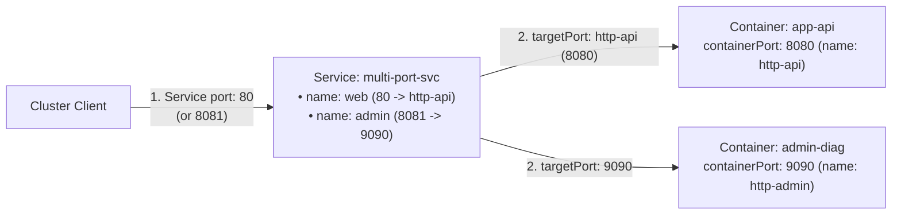
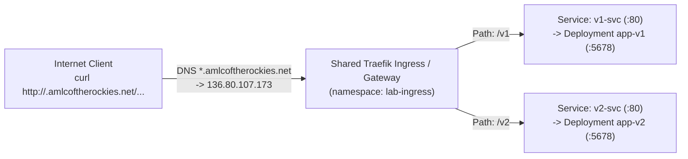

# Section 9: Services, Multi-Port Exposure, Ingress & HTTP Routing

Welcome to Section 9! Together with [Section 4, Module 3 (ClusterIP, NodePort & CoreDNS)](../section%204/README.md#3-module-3-networking-and-service-discovery) and [Section 8, Module 3 (NetworkPolicies)](../section%208/README.md#3-module-3-networkpolicies-for-application-isolation), this standalone lab completes the **CKAD Services and Networking (20%)** domain.

> [!NOTE]
> **Self-Contained Lab:** This section does not depend on resources from earlier sections. You will use your personal `<namespace>.amlcoftherockies.net` hostname to expose live HTTP applications to the internet!

In this section, you will practice:
1.  **Exposing Applications on Multiple & Named Ports**: Understanding `port` vs. `targetPort` (numeric and named container ports) vs. `nodePort`, and building a **Multi-Port Service**.
2.  **Service Types & CoreDNS Service Discovery (`ClusterIP`, `NodePort`, `LoadBalancer`, `ExternalName`)**: Comparing all 4 Kubernetes Service types and testing `ExternalName` DNS CNAME mapping.
3.  **Standard Kubernetes `Ingress` (`networking.k8s.io/v1`)**: Routing internet HTTP traffic to multiple backend services by URL path (`/v1` vs. `/v2`) using `IngressClass: traefik`.
4.  **Modern L7 Routing with the Gateway API (`HTTPRoute`)**: Attaching routes to the shared `Gateway`, routing by HTTP headers (`X-Canary: true`), and performing weighted canary traffic splits (`75%` / `25%`).

---

## 🔌 Module 1: Exposing Applications on Different & Multiple Ports

On the CKAD exam, applications often listen on non-standard ports (like `8080`, `5678`, or `9090`), while clients expect to connect to standard Service ports (like `80`), or a single Pod exposes both an application port and an admin/metrics port.

### 1.1 `port` vs. `targetPort` vs. `nodePort` (and Named Ports)



*   **`port` (Service Port)**: The virtual TCP/UDP port exposed on the Service's `ClusterIP` (what clients call, e.g., `http://my-svc:80`).
*   **`targetPort` (Container Port)**: The actual port the container process listens on inside the Pod (e.g., `8080`). Can be a **number** (`8080`) or a **named port** (`http-api`) defined in the Pod's `containers[*].ports[*].name`.
    *   *Why use named ports?* If you later change the container's listening port in the Deployment from `8080` to `8443` and keep `name: http-api`, you never have to modify the Service!
*   **`nodePort` (`30000–32767`)**: Only used by `type: NodePort` and `type: LoadBalancer`. Opens a static port on every worker node's network interface.

> [!IMPORTANT]
> **CKAD Multi-Port Rule:** Whenever a Kubernetes `Service` defines **more than one port** in `spec.ports`, **every port entry MUST have a unique `name:` field** (e.g., `name: web`, `name: admin`). Omitting `name` on a multi-port Service causes `kubectl apply` to fail validation!

---

### 1.2 Hands-On: Deploying & Testing a Multi-Port Service

Review [manifests/multi-port-svc.yaml](manifests/multi-port-svc.yaml). It deploys `multi-port-pod` (listening on ports `8080` and `9090`) and `multi-port-svc` (exposing Service port `80 -> http-api` and Service port `8081 -> 9090`).

1.  **Apply the manifest and wait for the Pod:**
    ```bash
    cd "section 9"
    kubectl apply -f manifests/multi-port-svc.yaml
    kubectl wait --for=condition=Ready pod/multi-port-pod --timeout=60s
    ```

2.  **Inspect the Service and its Endpoints:**
    ```bash
    kubectl get svc multi-port-svc
    kubectl describe svc multi-port-svc
    ```
    *Look at the `Endpoints` lines in `describe`: Kubernetes automatically resolved `targetPort: http-api` to `<PodIP>:8080` and `targetPort: 9090` to `<PodIP>:9090`!*

3.  **Call both Service ports (`80` and `8081`):**
    ```bash
    # Port 80 routes to container port 8080 (app-api):
    kubectl exec multi-port-pod -c debug-client -- wget -qO- http://multi-port-svc:80

    # Port 8081 routes to container port 9090 (admin-diag):
    kubectl exec multi-port-pod -c debug-client -- wget -qO- http://multi-port-svc:8081
    ```
    *Output:*
    ```text
    Main Application API (Container Port 8080)
    Admin Diagnostics Endpoint (Container Port 9090)
    ```

---

## 🧭 Module 2: Service Types & CoreDNS Service Discovery

### 2.1 Comparing All Four Kubernetes Service Types

| Service Type | Scope | How It Works |
| :--- | :--- | :--- |
| **`ClusterIP`** *(Default)* | Internal to the cluster | Allocates a stable virtual IP (`10.24.x.x`) and CoreDNS `A` record (`<svc>.<ns>.svc.cluster.local`). |
| **`NodePort`** | Cluster nodes (`30000–32767`) | Builds on `ClusterIP` and opens a static port on every worker node (`<NodeIP>:<NodePort>`). |
| **`LoadBalancer`** | External (L4 Cloud LB) | Builds on `NodePort` and provisions a dedicated cloud load balancer per Service. *(Disabled by quota on our shared cluster in favor of the shared L7 Ingress/Gateway below!)* |
| **`ExternalName`** | DNS Alias (`CNAME`) | Allocates **no IP address** and proxies no traffic. Instead, CoreDNS returns a **`CNAME` record** pointing `<svc>.<ns>.svc.cluster.local` to an external hostname (e.g., a managed cloud database `db.example.com`). |

### 2.2 Hands-On: Creating an `ExternalName` Service & Testing CoreDNS

Suppose your application code is hardcoded to connect to `http://external-payments`, which lives outside your namespace (or outside the cluster at `api.amlcoftherockies.org`).

1.  **Create an `ExternalName` Service imperatively:**
    ```bash
    kubectl create service externalname external-payments --external-name=amlcoftherockies.org
    kubectl get svc external-payments
    ```
    *Notice `TYPE` is `ExternalName`, `CLUSTER-IP` is `<none>`, and `EXTERNAL-IP` shows `amlcoftherockies.org`!*

2.  **Query CoreDNS for the `ExternalName` Service FQDN:**
    ```bash
    NS=$(kubectl config view --minify -o jsonpath='{..namespace}')
    kubectl exec multi-port-pod -c debug-client -- nslookup external-payments.$NS.svc.cluster.local
    ```
    *CoreDNS resolves `external-payments.<ns>.svc.cluster.local` directly via a `CNAME` to `amlcoftherockies.org`!*

---

## 🌐 Module 3: HTTP(S) Routing with Kubernetes `Ingress` (`networking.k8s.io/v1`)

While a `LoadBalancer` Service operates at **Layer 4 (TCP/UDP)** and requires a separate cloud load balancer (and public IP) for every single Service, an **`Ingress`** operates at **Layer 7 (HTTP/HTTPS)**. One shared Ingress Controller (in our cluster, **Traefik** behind `136.80.107.173`) can route traffic for dozens of hostnames and URL paths!



### 3.1 Key `Ingress` Concepts for CKAD
1.  **`ingressClassName`**: Tells Kubernetes which Ingress Controller should implement the Ingress. Check the cluster's available classes:
    ```bash
    kubectl get ingressclass
    ```
    *You will see `traefik`.*
2.  **`pathType` (Required on every path!)**:
    *   **`Prefix`**: Matches the URL path prefix split by `/` (e.g., `/v1` matches `/v1`, `/v1/`, and `/v1/users`, but NOT `/v10`).
    *   **`Exact`**: Matches the exact URL path only (`/v1` matches `/v1`, not `/v1/`).

---

### 3.2 Hands-On: Exposing `/v1` and `/v2` on the Internet with `Ingress`

1.  **Deploy the two backend Deployments (`app-v1`, `app-v2`) and Services (`v1-svc`, `v2-svc`):**
    Review and apply [manifests/backends.yaml](manifests/backends.yaml). Notice that the containers listen on port **`5678`**, while `v1-svc` and `v2-svc` expose port **`80`** (`targetPort: 5678`):
    ```bash
    kubectl apply -f manifests/backends.yaml
    kubectl rollout status deployment/app-v1 deployment/app-v2
    ```

2.  **Set your personal workshop hostname and apply [manifests/ingress-paths.yaml](manifests/ingress-paths.yaml):**
    ```bash
    NS=$(kubectl config view --minify -o jsonpath='{..namespace}')
    export MY_HOST="${NS}.amlcoftherockies.net"
    echo "My live hostname is: http://${MY_HOST}"

    sed "s/MY_HOST/${MY_HOST}/g" manifests/ingress-paths.yaml | kubectl apply -f -
    kubectl get ingress app-ingress
    ```

3.  **Test live HTTP path routing from your laptop!**
    ```bash
    curl http://${MY_HOST}/v1
    curl http://${MY_HOST}/v2
    ```
    *Output:*
    ```text
    Served by Backend v1 (Stable)
    Served by Backend v2 (New Release)
    ```

4.  **Delete the `Ingress` before testing the Gateway API in Module 4** (so both don't claim the same hostname at once):
    ```bash
    kubectl delete ingress app-ingress
    ```

---

## 🚀 Module 4: Modern L7 Routing with the Gateway API (`HTTPRoute`)

The **Kubernetes Gateway API** (`gateway.networking.k8s.io/v1`) is the modern successor to `Ingress`. It splits responsibilities cleanly between:
*   **Platform Admins**: Manage the **`GatewayClass`** (`traefik`) and the shared **`Gateway`** (`lab-gateway` in namespace `lab-ingress`).
*   **Application Developers (You!)**: Create **`HTTPRoute`** resources in your own namespace and attach them to the shared `Gateway` via `parentRefs`.

Unlike `Ingress` (which needed vendor-specific annotations for header matching, traffic splitting, or rewrites), **`HTTPRoute` supports header routing, query matching, URL rewrites, and weighted canary traffic splitting natively in standard Kubernetes YAML!**

### 4.1 Hands-On: Header Routing & Weighted Traffic Splitting with `HTTPRoute`

1.  **Inspect the cluster's `GatewayClass` and shared `Gateway`:**
    ```bash
    kubectl get gatewayclass
    kubectl get gateway -n lab-ingress
    ```

2.  **Review and apply [manifests/httproute-advanced.yaml](manifests/httproute-advanced.yaml):**
     It defines two rules on your `MY_HOST` hostname:
    *   **Rule 1 (Header Match)**: Requests carrying HTTP header `X-Canary: true` are routed **100% to `v2-svc`**.
    *   **Rule 2 (Weighted Split)**: All other requests to `/` are split **75% to `v1-svc`** and **25% to `v2-svc`**.
    ```bash
    sed "s/MY_HOST/${MY_HOST}/g" manifests/httproute-advanced.yaml | kubectl apply -f -
    kubectl get httproute app-httproute
    ```

3.  **Test Weighted Traffic Splitting (`75% v1 / 25% v2`):**
    Send 8 regular HTTP requests from your laptop:
    ```bash
    for i in 1 2 3 4 5 6 7 8; do curl -s http://${MY_HOST}/; done
    ```
    *You will see roughly 6 responses from `Backend v1 (Stable)` and 2 responses from `Backend v2 (New Release)`!*

4.  **Test Header-Based Routing (`X-Canary: true`):**
    Now pass `-H "X-Canary: true"` — every single request is deterministically routed to `Backend v2`:
    ```bash
    for i in 1 2 3 4; do curl -s -H "X-Canary: true" http://${MY_HOST}/; done
    ```
    *All 4 responses return `Served by Backend v2 (New Release)`!*

---

## 🧹 Cleaning Up

Clean up all resources created in this section:
```bash
kubectl delete httproute app-httproute --ignore-not-found
kubectl delete ingress app-ingress --ignore-not-found
kubectl delete svc external-payments --ignore-not-found
kubectl delete -f manifests/backends.yaml -f manifests/multi-port-svc.yaml --ignore-not-found
```
